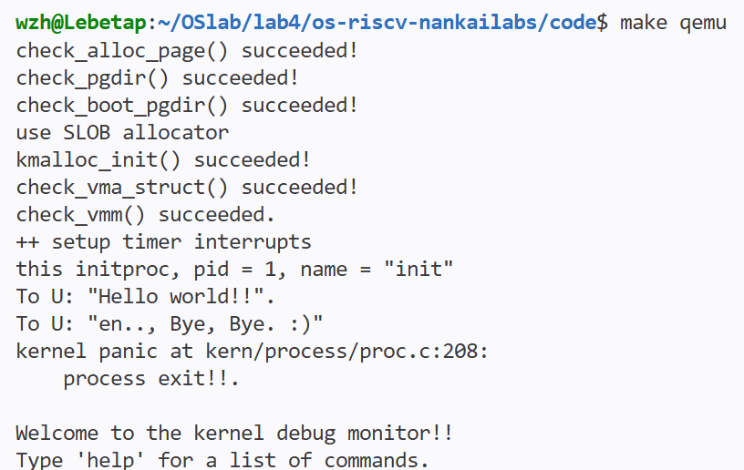
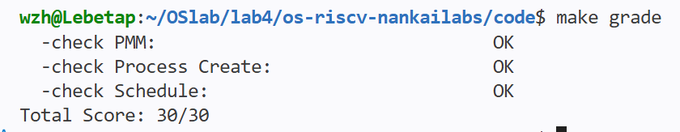

# 操作系统实验报告

## 实验基本信息

| 项目 | 内容 |
|---|---|
| **实验名称** | Lab 4：进程管理 |
| **小组成员** | 2411353-李行阳、2412195-邵毅、2412352-王治中 |
| **完成日期** | 2026-11-21 |

### 小组分工

| 成员           | 负责的练习/模块                         |
| -------------- | --------------------------------------- |
| 2411353-李行阳 | 功能模块三：进程调度；Challenge 1       |
| 2412195-邵毅   | 功能模块二：进程创建及初始化            |
| 2412352-王治中 | 功能模块一：虚拟内存页操作；Challenge 2 |

---

## 一、实验目的

本实验需要完成两件事：引入 `mm_struct`/`vma_struct` 虚拟内存描述结构，以预映射方式搭好地址空间框架；再建立内核线程机制，让内核能够创建、调度并切换多个执行流。

本实验的主要目的是：

1. 理解虚拟内存管理的两层结构：`mm_struct`/`vma_struct` 描述地址空间的布局，映射的建立与撤销由 `page_insert`/`page_remove` 直接操作多级页表完成，并保持页表项内容、页引用计数、TLB 三者一致。
2. 理解内核线程与进程的关系，掌握 `proc_struct` 的组织方式（状态、内核栈、上下文、共享内核地址空间）。
3. 掌握内核线程的创建流程（`kernel_thread`→`do_fork`）与切换流程（`schedule`→`proc_run`→`switch_to`）。

具体地，本实验需要完成：

- 在 `kern/mm/pmm.c` 中实现 `page_insert()` 与 `page_remove()`（功能模块一）；
- 在 `kern/process/proc.c` 中实现 `alloc_proc()`（功能模块二）；
- 在 `kern/process/proc.c` 中实现 `proc_run()` 与 `cpu_idle()`（功能模块三）；

---

## 二、实验环境

| 成员 | AI 编程工具 | 底层模型 | 备注 |
|---|---|---|---|
| 2411353-李行阳 | Claude Code（终端） | DeepSeek-V4.1-flash | |
| 2412195-邵毅 | DeepSeek Harness（Web UI） | DeepSeek-flash | |
| 2412352-王治中 | ZCode（终端 Agent） | GLM-5.3-Flash | |

**说明：**

- **AI 编程工具**：指具体使用的终端工具、编辑器插件、桌面应用或浏览器界面
- **底层模型**：指该工具使用的大语言模型及版本

---

## 三、实验整体逻辑分析

### 3.1 本章节的逻辑主线

Lab 2 之后，内核只有一张内核页表和一条执行流。运行多个内核线程需要三个基础：**共享页表的映射维护、线程的描述与创建、线程间的现场切换**。

- **模块一维护页表**：`page_insert` 把物理页挂到线性地址，`page_remove` 撤销映射，页表项、引用计数、TLB 随每次更新保持一致。
- **模块二创建线程**：`proc_struct` 记录线程的状态、内核栈，以及它使用的页表根 `pgdir`；`proc_init` 把当前执行流包装成 idleproc，`kernel_thread`/`do_fork` 创建 initproc。
- **模块三切换线程**：`cpu_idle` 让出 CPU，`schedule` 选中就绪线程，`proc_run` 把它的 `pgdir` 写入 `satp`，`switch_to` 换栈换 PC。

三个模块由**两条线**串起来：`pgdir` 从模块一维护的页表出发，被模块二写进每个线程的 `proc_struct`，模块三在切换时把它装进 `satp`；执行流则从 `proc_init` 创建的 idleproc 出发，经调度到达 initproc。

### 3.2 功能的逐步实现

1. **页表操作（模块一）**：`page_insert`/`page_remove` 负责映射的建立与撤销，并同步维护页表项内容、引用计数与 TLB。
2. **线程创建（模块二）**：`alloc_proc` 初始化 PCB，`pgdir` 指向模块一维护的内核页表根；`proc_init` 由此包装出 idleproc，`kernel_thread`→`do_fork` 创建 initproc。
3. **调度与切换（模块三）**：`cpu_idle` 在 `need_resched` 置位时调用 `schedule`，调度器按 FIFO 策略从 `proc_list` 选取就绪线程；`proc_run` 在关中断窗口内切换 `satp` 并执行 `switch_to`，模块二创建的 initproc 由此得到运行。

与线程直接相关的简化调用链：

```text
kern_init()
  → pmm_init()               // 模块一：check_pgdir / check_boot_pgdir 验证映射维护
  → vmm_init()               // mm/vma 结构自检
  → proc_init()              // 模块二：idleproc ← alloc_proc；initproc ← kernel_thread → do_fork → alloc_proc
  → cpu_idle()               // 模块三：need_resched → schedule → proc_run → switch_to
```

---

## 四、实验内容与实现

本章的三个功能模块分别对应页表映射的建立与撤销、线程的描述与创建、线程的调度与切换。

### 功能模块一：虚拟内存页操作

**负责人：** 2412352-王治中

#### 模块功能描述

本模块涉及 `kern/mm/pmm.c` 中的两个函数：

```c
int page_insert(pde_t *pgdir, struct Page *page, uintptr_t la, uint32_t perm);   // pmm.c:286-315
void page_remove(pde_t *pgdir, uintptr_t la);                                     // pmm.c:322-336
```

**作用：** 在 Lab 2 建立的三级页表（Sv39）上提供两个基本动作：把物理页挂到指定线性地址（`page_insert`），把已有映射安全撤销（`page_remove`）。两者共同决定一个线性地址最终对应哪一页物理内存，并保证每次更新后页表项内容、`struct Page` 引用计数、TLB 三者一致。

**主要场景：** 同页重映射（只改权限）、换页重映射（旧页计数归零被释放）、删除映射（含对未映射地址的删除）。

**与其他模块/框架的交互：**

- 依赖 `get_pte`（定位并按需分配中间页表）、`pte_create`/`pte2page`（表项编码与解码）、`page_ref_inc/dec`（引用计数）、`tlb_invalidate`（`sfence.vma`）。
- 模块二/三建立的线程共享内核页表，对该页表的后续更新都经由本模块维护。

#### 最终提示词

本模块的接口与边界条件从框架已有的 `get_pte`/`pte_create` 约定反推得到。最终使用的提示词如下：

~~~text
[PROMPT]
**任务**：修改 kern/mm/pmm.c，在 `//LAB4 function1 YOUR CODE` 标记下方实现虚拟内存页映射维护功能。

**操作要求**：在项目中修改实际文件，保留现有代码，仅在标记位置补全。

**输出要求**：直接进行文件操作，依据 [RELY]、[GUARANTEE]、[SPECIFICATION] 实现，不引入无关功能。

[RELY]
可用接口：`get_pte(pgdir, la, create)`（需分配中间页表时可能返回 NULL）、`pte_create`、`pte2page`、`page_ref_inc/dec`、`set_page_ref`、`alloc_page`、`free_page`、`tlb_invalidate`；权限宏 `PTE_V`、`PTE_W`、`PTE_R`、`PTE_U`。

[GUARANTEE]

```c
int page_insert(pde_t *pgdir, struct Page *page, uintptr_t la, uint32_t perm);
void page_remove(pde_t *pgdir, uintptr_t la);
```

[SPECIFICATION]

## page_insert

**Pre-Condition**: page 指向一个已分配的有效物理页，la 为待映射的线性地址。
**Post-Condition**: 成功时返回 0，la 稳定映射到 page，权限位设置为 PTE_V|perm，页表项内容、页引用计数、TLB 状态三者保持同步；当 get_pte 需要分配中间级页表页而分配失败时，返回 -E_NO_MEM，且不能留下半完成的映射。
  **Case 1**: la 原本已映射到同一物理页：不重复增减引用计数，仅将页表项权限更新为 perm 并失效对应 TLB。
  **Case 2**: la 原本已映射到其他物理页：不能简单覆盖旧表项，须先撤销旧映射（旧页引用计数减一，计数为 0 时释放该页），再建立新映射并增加引用计数。

## page_remove

**Pre-Condition**: la 为任意线性地址，函数需自行判断映射是否存在。
**Post-Condition**: 作为幂等的删除接口：la 存在有效映射时，清除该页表项，对应物理页引用计数减一，计数为 0 时释放该页，并失效对应 TLB；la 未映射时安静返回，不把未映射地址当作异常。
~~~

#### 核心函数与实现理解

`page_insert` 的执行过程：

- `get_pte(pgdir, la, 1)` 定位表项，需要时逐级分配中间级页表页；任一级页表分配失败，`page_insert` 会直接返回 `-E_NO_MEM`。失败发生在写入 la 的页表项之前，所以 la 仍是未映射状态；已经分配出去的中间级页表页留在页表中，后续映射同一区域的地址时会继续使用，**不需要回滚**。
- 先对目标页 `page_ref_inc` 再检查旧表项：如果旧映射和目标页是同一页，`page_ref_dec` 抵消；如果是其他页，则调用 `page_remove(pgdir, la)` 撤销。**先加后查**保证目标页的计数全程不为 0，即使旧映射就是本页，也不会在仍有映射时被回收。
- `pte_create` 整体重写表项，权限位为 `PTE_V|perm`，旧权限位随之清除，随后失效对应 TLB。

另外，引用计数一律经 `page_ref_inc/dec` 增减，不用 `set_page_ref` 直接赋值，避免覆盖其他映射的计数。

```c
int page_insert(pde_t *pgdir, struct Page *page, uintptr_t la, uint32_t perm)
{
    pte_t *ptep = get_pte(pgdir, la, 1);
    if (ptep == NULL)
    {
        return -E_NO_MEM;
    }
    page_ref_inc(page);
    if (*ptep & PTE_V)
    {
        struct Page *p = pte2page(*ptep);
        if (p != page)
        {
            page_remove(pgdir, la);
        }
        else
        {
            page_ref_dec(page);
        }
    }
    *ptep = pte_create(page2ppn(page), PTE_V | perm);
    tlb_invalidate(pgdir, la);
    return 0;
}
```

`page_remove` 的处理流程：

- 用 `get_pte(pgdir, la, 0)` 定位且不会触发页表分配；若表项不存在或无 `PTE_V` 都直接返回，确保对同一地址重复删除是安全的。
- 如果是有效映射，则把 `page` 的引用计数减一，归 0 时用 `free_page` 回收，随后清空表项并失效对应 TLB。

```c
void page_remove(pde_t *pgdir, uintptr_t la)
{
    pte_t *ptep = get_pte(pgdir, la, 0);
    if (ptep != NULL && (*ptep & PTE_V))
    {
        struct Page *page = pte2page(*ptep);
        page_ref_dec(page);
        if (page_ref(page) == 0)
        {
            free_page(page);
        }
        *ptep = 0;
        tlb_invalidate(pgdir, la);
    }
}
```

#### 实现迭代过程

本模块共 1 次生成迭代。

##### 第一次迭代

- **结果**：AI 按 spec 生成两个函数，`pmm.c` 编译零警告；
- **验证**：当时模块二/三未合入，所以让 AI 用临时桩（`proc_init`/`cpu_idle` 空实现）链接内核，QEMU 实机自检全部通过，桩与构建产物随后删除。

**最终结果：**

- ✅ 编译零警告；
- ✅ 实机自检全部通过。

---

### 功能模块二：进程创建及初始化

**负责人：** 2412195-邵毅

#### 模块功能描述

本模块让内核从只有一条执行流，发展到能**创建、登记并首次运行多个内核线程**。它位于 `kern/process/proc.c`，需要实现六个函数：

| 函数 | 职责 |
|---|---|
| `alloc_proc` | 分配并初始化一个干净的 PCB |
| `proc_init` | 初始化进程管理全局结构，包装 `idleproc`，创建 `initproc` |
| `kernel_thread` | 把普通函数入口和参数包装成线程首次运行的 trapframe |
| `do_fork` | 组合 PCB、内核栈、地址空间、trapframe/context，挂入全局结构并唤醒 |
| `copy_thread` | 把 trapframe 和 context 安放到新线程自己的内核栈上 |
| `copy_mm` | 当前阶段只做地址空间占位，不复制用户 mm |

整体调用链为：

```text
kern_init()
  → pmm_init() / vmm_init()          // 前置实验已完成
  → proc_init()
      → alloc_proc()                 // idleproc
      → kernel_thread(init_main, ...)
          → do_fork()
              → alloc_proc()         // initproc
              → setup_kstack()
              → copy_mm()
              → copy_thread()
              → get_pid()/hash_proc()/list_add()/wakeup_proc()
      → find_proc(pid)               // initproc
  → cpu_idle()
  → schedule()
  → proc_run()
  → switch_to()
```

模块二负责前半段：`proc_init` 及 `kernel_thread → do_fork → copy_thread` 的创建路径；模块三负责后半段：从 `cpu_idle` 开始选择并切换到 `initproc`。两个模块的**交接点**是 `copy_thread` 写入的 `context.ra = forkret`、`context.sp = proc->tf`，以及 `kernel_thread` 写入 trapframe 的 `s0 = fn`、`s1 = arg`、`epc = kernel_thread_entry`。新线程第一次被 `switch_to` 切换时，从 `forkret → forkrets → __trapret → sret → kernel_thread_entry → jalr s0` 进入 `fn(arg)`。

#### 最终提示词

````text
[PROMPT]
在 ucore lab4 中实现功能模块二：补全 `alloc_proc`、`proc_init`、`kernel_thread`、`do_fork`、`copy_thread`、`copy_mm`，把当前执行现场包装为 `idleproc`，并创建可被调度的 `initproc`；只改 `kern/process/proc.c` 的 `//lab4 function2 2412195` 标记处，不改其他文件、数据结构及 `do_exit` 占位实现。
[RELY]
已有 PCB、上下文、trapframe、进程链表与哈希表、`idleproc/initproc/current`、`nr_process`；可用 `kmalloc/kfree`、`find_proc/get_pid`、`hash_proc/setup_kstack/put_kstack/wakeup_proc`、`list_init/list_add`、`local_intr_save/restore`、`read_csr`、`assert/panic`；`boot_pgdir_pa` 为页表根物理地址，`bootstack` 为启动栈；常量、错误码和首次运行入口链路均已具备。
[GUARANTEE]
实现上述六个接口，其中 `alloc_proc`、`copy_thread`、`copy_mm` 为 `static`；签名不变。
[SPECIFICATION]
- alloc_proc：分配并初始化 PCB；页表根用 `boot_pgdir_pa`，链表节点自环；失败返回 `NULL`。不分配内核栈/PID、不挂链。
- proc_init：初始化进程链表与哈希表；建 `idleproc`（pid=0、复用启动栈、标记需要重新调度）并令其为 `current`，再创建 `initproc`（pid=1）。`idleproc` 不挂链，必须先设 `current` 再创建。
- kernel_thread：构造 trapframe，设置入口、参数和返回状态（S 模式、开中断）；以 `esp=0` 调 `do_fork`。
- do_fork：检查上限；分配 PCB 与内核栈、处理 mm、复制现场；在关中断临界区分配 PID、挂链并计数；最后唤醒。失败先释放内核栈再释放 PCB。
- copy_thread：在新内核栈顶安放 trapframe 副本，返回现场指向 `forkret`，栈指针指向 trapframe。
- copy_mm：只建内核线程，断言当前无用户 mm 后返回 0；保留接口供 lab5 扩展。
- 验收：`make` 通过；`make grade` 的 `[Test Process Create]` PASS。
````

#### 核心函数与实现理解

**`alloc_proc`**：`kmalloc` 后把 PCB 初始化为空白状态（`PROC_UNINIT`、`pid=-1`、链表节点自环），`pgdir` 直接取内核页表根物理地址 `boot_pgdir_pa`；内核栈、PID 和挂链留给后续步骤。

```c
proc->pgdir = boot_pgdir_pa;    // 页表根物理地址，proc_run 直接写入 satp
```

**`proc_init`**：初始化进程链表和哈希桶，把当前执行现场包装成 `idleproc`（`pid=0`、复用 `bootstack`、`need_resched=1`），令 `current=idleproc` 后再创建 `initproc`（`pid=1`）；`idleproc` 不挂链，只作调度兜底。

**`kernel_thread`**：在栈上构造 trapframe，入口和参数放入 `s0/s1`，`epc` 指向 `kernel_thread_entry`，并设置 `status` 使 `sret` 返回 S 模式且开中断；以 `stack=0` 调 `do_fork`，让新线程使用自己分配的内核栈。

```c
tf.gpr.s0 = (uintptr_t)fn;                  // 线程入口
tf.gpr.s1 = (uintptr_t)arg;                 // 参数
tf.epc = (uintptr_t)kernel_thread_entry;
tf.status = (read_csr(sstatus) & ~(uintptr_t)SSTATUS_SIE) |
            SSTATUS_SPP | SSTATUS_SPIE;     // sret 后回到 S 模式且开中断
```

**`do_fork`**：分配 PCB 和内核栈，调用 `copy_mm`、`copy_thread`；PID、哈希、链表和计数放在同一关中断临界区，完成后才唤醒。失败时先释放内核栈再释放 PCB。

**`copy_thread`**：把 trapframe 副本放在新内核栈顶部，`a0=0`；`context.ra=forkret`、`context.sp=tf`，使新线程经 `forkret → forkrets → __trapret → sret → kernel_thread_entry` 首次运行。

```c
proc->tf = (struct trapframe *)(proc->kstack + KSTACKSIZE) - 1;
*(proc->tf) = *tf;                          // 中断帧放在内核栈顶
proc->tf->gpr.a0 = 0;
proc->context.ra = (uintptr_t)forkret;      // 首次切换的入口
proc->context.sp = (uintptr_t)(proc->tf);   // forkrets 要求 sp 指向中断帧
```

**`copy_mm`**：只创建内核线程，断言 `current->mm == NULL` 后返回 0，保留接口供 lab5 扩展。

#### 实现迭代过程

本模块共 1 次生成迭代。

##### 第一次迭代

- **结果**：AI 按上述 spec 一次生成六个函数，通过编译和评分；
- **验证**：由于模块三未合入，所以由 AI 临时插入空桩（`cpu_idle`/`proc_run`/`schedule`）使内核可运行，单独运行 Test Process Create 即 PASS，桩随后删除。
- **实现要点**：
  1. **`pgdir` 用物理地址。** `alloc_proc` 写 `boot_pgdir_pa`，而不是 `boot_pgdir_va`。`proc_run` 会把 `pgdir` 右移 `RISCV_PGSHIFT` 后写入 `satp`，这里必须是物理地址；写成虚拟地址会导致切换后页表根错误。
  2. **`tf.status` 的三个位。** `kernel_thread` 清除 `SIE`、置位 `SPP` 和 `SPIE`。`sret` 用 `SPP` 决定返回模式、用 `SPIE` 恢复 `SIE`；少置 `SPP` 会回到错误特权级，少置 `SPIE` 会让新线程首次运行关中断。
  3. **`context.sp` 指向 trapframe。** `copy_thread` 把 `context.sp` 设为 `proc->tf`，而不是 `kstack + KSTACKSIZE`。`forkret` 的栈必须从 trapframe 下方开始，`forkrets` 也要求 `sp` 正好指向 trapframe；指向栈顶会覆盖 trapframe 或让恢复现场错位。
  4. **失败清理顺序。** `do_fork` 的 `copy_mm` 失败路径先 `put_kstack(proc)` 再 `kfree(proc)`；反过来会在 PCB 释放后读取 `proc->kstack`。
  5. **挂链临界区与 idleproc 不挂链。** `get_pid`、`hash_proc`、`list_add`、`nr_process++` 放在同一个关中断区内；`idleproc` 作为调度兜底留在 `proc_list` 外，避免被当成普通线程反复选中。

**最终结果：**

- ✅ `make` 通过；
- ✅ `make grade` 的 check Process Create 通过。

---

### 功能模块三：进程调度

**负责人：** 2411353-李行阳

#### 模块功能描述

本模块负责把已创建的内核线程交给 CPU 执行，调用链为 `cpu_idle → schedule → proc_run → switch_to`。

| 函数 | 位置 | 职责 |
|---|---|---|
| `cpu_idle` | `kern/process/proc.c` | idle 线程主体，检查 `need_resched` 并让出 CPU |
| `schedule` | `kern/schedule/sched.c` | 从 `proc_list` 选择下一个 `PROC_RUNNABLE` 线程 |
| `proc_run` | `kern/process/proc.c` | 切换 `current`、`satp` 和上下文 |
| `switch_to` | `kern/process/switch.S` | 保存/恢复寄存器现场 |

本模块只负责选择和切换执行流，不创建线程、不分配内核栈。线程的初始现场由模块二准备：`kernel_thread` 把入口和参数写入 `trapframe` 的 `s0/s1`，`copy_thread` 设置 `context.ra=forkret`、`context.sp=tf`。

#### 最终提示词

spec 按提示词模板书写：每个函数写清输入、边界和验收标准，不写实现步骤；prompt 用四段式，分别给目标、最小上下文、可用接口和可验证行为。

````markdown
[PROMPT]
在 ucore lab4 中实现功能模块三：补全 cpu_idle、schedule、proc_run、switch_to，不修改框架其他文件、数据结构、宏和测试。

[RELY]
已有 proc_struct、context、trapframe、proc_list、idleproc、current、PROC_RUNNABLE；已有 local_intr_save/restore、list_next、le2proc、write_csr、SATP_MODE_SV39、RISCV_PGSHIFT、flush_tlb；模块二已完成线程创建，并设置 context.ra=forkret、context.sp=tf、trapframe 的 s0/s1/epc。

[GUARANTEE]
可用上述接口；context 字段顺序必须与 switch.S 的偏移一致；不要使用 Sv32 遗留的 lsatp()。

[SPECIFICATION]
- cpu_idle：循环检查 need_resched，必要时调用 schedule。
- schedule：关中断；清 need_resched；按 RR 扫描 proc_list，跳过 &proc_list，选第一个 PROC_RUNNABLE；找不到回退 idleproc；next != current 时调用 proc_run。
- proc_run：切换 current、satp 和上下文，三者保持原子；写 satp 后调用 flush_tlb。
- switch_to：按 context 顺序保存/恢复 ra、sp、s0～s11，ret 跳到 to->context.ra。
- 边界：链表为空不崩溃；找不到就绪线程回退 idle。
- 验收：make 通过；make grade 中 [Test Schedule] PASS，30/30。
````

#### 核心函数与实现理解

**`cpu_idle`** 是 idle 线程主体。`proc_init` 把 `idleproc->need_resched` 置 1，因此第一次进入就会让出 CPU。lab4 的调度是协作式的，时钟中断只计时，不设置 `need_resched`。

**`schedule`** 负责选线程。关中断后清 `need_resched`；当前是 idle 时从链表头开始，否则从当前线程的下一个开始；跳过 `&proc_list` 哨兵，用 `le2proc` 取出 `proc_struct`；找不到就绪线程就回退 `idleproc`；只有 `next != current` 才调用 `proc_run`。

```c
last = (current == idleproc) ? &proc_list : &(current->list_link);  // idle 不在链表里，从头开始
le = last;
do
{
    if ((le = list_next(le)) != &proc_list)     // 跳过哨兵节点
    {
        next = le2proc(le, list_link);
        if (next->state == PROC_RUNNABLE)
        {
            break;
        }
    }
} while (le != last);
if (next == NULL || next->state != PROC_RUNNABLE)
{
    next = idleproc;                             // 找不到就绪线程，回退 idle
}
```

**`proc_run`** 负责真正切换。先判断 `proc == current`，然后在临界区内更新 `current`、切换页表（写 `satp` 后刷新 TLB）和上下文（`switch_to`）。三者必须原子完成，否则线程会拿到不一致的页表或现场。

```c
local_intr_save(intr_flag);
{
    current = proc;
    write_csr(satp, ((uintptr_t)SATP_MODE_SV39 << 60) |
                    (next->pgdir >> RISCV_PGSHIFT));
    flush_tlb();
    switch_to(&(prev->context), &(next->context));
}
local_intr_restore(intr_flag);
```

**`switch_to`** 只搬寄存器。按 `struct context` 的偏移保存/恢复 `ra/sp/s0～s11`，最后 `ret` 跳到 `to->context.ra`。只保存 callee-saved 寄存器和 `ra/sp`，因为调用者保存寄存器已由编译器在调用点处理。

```asm
switch_to:
    STORE ra,  0 * REGBYTES(a0)     # 保存 from 的 ra/sp/s0-s11
    STORE sp,  1 * REGBYTES(a0)
    ...
    LOAD  ra,  0 * REGBYTES(a1)     # 恢复 to 的现场
    LOAD  sp,  1 * REGBYTES(a1)
    ...
    ret                             # 跳到 to->context.ra（新线程为 forkret）
```

`satp` 写入的是 Sv39 模式位加页表根物理页号；写 `satp` **不会自动刷新 TLB**，所以要调用 `flush_tlb()`。lab4 中所有线程共享同一页表，实际写入同一个值；写法为后续独立页表保留。

**首次运行链路。** 新线程第一次被切换时，`context.ra` 是 `copy_thread` 预设的 `forkret`；从它开始依次经过 `forkrets → __trapret → sret → kernel_thread_entry → jalr s0`，最终调用 `fn(arg)`。模块三只负责把 CPU 交到 `forkret`，完整现场由 trap 返回路径恢复。

#### 实现迭代过程

本模块共 1 次生成迭代。

##### 第一次迭代

- **结果**：AI 按上述 spec 一次生成四个函数，通过编译和评分；
- **验证**：`make` 通过；`make grade` 中 PMM、Process Create、Schedule 均通过（30/30）；`make qemu` 中 `initproc` 打印 `Hello world!!` / `Bye, Bye.`，随后 `do_exit` panic；
- **实现要点**：
  1. `satp` 用 `write_csr` 构造而不是 `lsatp()`；

  2. `schedule`/`proc_run` 用 `local_intr_save/restore` 保护；

  3. `switch_to` 的偏移与 `struct context` 一致。

**最终结果：**

- ✅ 编译通过；
- ✅ `make grade` 30/30，initproc 输出符合预期。

---

### Challenge 1：`local_intr_save` / `local_intr_restore` 如何实现开关中断

**负责人：** 2411353-李行阳

```c
static inline bool __intr_save(void) {
    if (read_csr(sstatus) & SSTATUS_SIE) {
        intr_disable();
        return 1;
    }
    return 0;
}

static inline void __intr_restore(bool flag) {
    if (flag) intr_enable();
}

#define local_intr_save(x)    do { x = __intr_save(); } while (0)
#define local_intr_restore(x) __intr_restore(x);
```

`local_intr_save(intr_flag)` 展开为 `intr_flag = __intr_save();`。`__intr_save` 读取 `sstatus.SIE`：原来开就关中断并返回 1，原来关就返回 0。`local_intr_restore` 只在 `flag == 1` 时重新开中断。两个函数配合，中间的部分便可以实现安全的关闭中断。

它保存的是进入临界区前中断是否开启的状态，而不是无条件打开，因此**支持嵌套**：内层 `flag=0` 不会打开外层仍想关闭的中断。宏用 `do { ... } while (0)` 包起来，是为了在语法上等价于一条语句，能安全放进不带大括号的 `if/else`。

---

### Challenge 2：深入理解不同分页模式的工作原理（思考题）

**负责人：** 2412352-王治中

`get_pte()` 中处理前两级的代码几乎完全一样：

```c
pde_t *pdep1 = &pgdir[PDX1(la)];            // 一级页目录，索引取自 la 的 PDX1 段
if (!(*pdep1 & PTE_V))
{
    /* create=1 时分配页表页：alloc_page、清零，
       *pdep1 = pte_create(page2ppn(page), PTE_U | PTE_V) */
}
pde_t *pdep0 = &((pte_t *)KADDR(PDE_ADDR(*pdep1)))[PDX0(la)];   // 二级页表，索引取自 PDX0 段
if (!(*pdep0 & PTE_V))
{
    /* 结构与上一段完全相同 */
}
return &((pte_t *)KADDR(PDE_ADDR(*pdep0)))[PTX(la)];            // 末级只查找、不分配
```

**两段代码为何如此相像。** 多级页表的每一级职责相同：用线性地址中的一段索引在本级表中找到表项，有效则取出下一级页表基址，无效且允许创建时分配新的页表页。这段查找与建立逻辑与级别无关，差别只有索引来源（`PDX1(la)`/`PDX0(la)`）和本级表基址（页表根或上级表项指向的页）。sv32、sv39、sv48 的共同点正是这种**自相似结构**：每级做同样的事，PTE 语义一致，最低 12 位都是页内偏移；差异只在级数与索引位宽——sv32 两级（每级 10 位，PTE 4 字节），sv39 三级、sv48 四级（每级 9 位，PTE 8 字节）。换成其他分页模式，这段逻辑只是重复次数不同；把处理一级的逻辑写成对级数的循环，`get_pte` 可以直接适配三种模式。

**查找与分配合并是否合理。** 合并的写法**在本实验中没有问题**：`page_insert`、`boot_map_segment` 等所有调用方需要的都是保证存在的表项，合并使它们不必重复先查找、无效时再分配的逻辑；是否分配由 `create` 参数控制，只读路径传 0 即可，不会产生意外分配。但从方便后续实现的角度看，**有必要把两者拆开**：查找是纯读操作，分配会产生副作用，拆开后两个函数职责单一，后续实验可以按需选择只查找或查找并建立，不必用布尔参数区分；分配失败的处理也更干净——合并时中间级分配失败会把先分配的上一级页表页留在页表中，拆开后可以直接回收。

---

## 五、测试与验证

### 5.1 `make qemu` 运行观察

`make qemu` 启动后，`pmm_init`/`vmm_init` 的自检依次通过，`proc_init` 创建的 initproc 被调度执行并打印信息；initproc 结束后按 `do_exit` 的占位实现进入 panic，停在内核调试监视器：



### 5.2 `make grade` 评分测试

`make grade` 由 `tools/inject.py` 注入测试后用 QEMU 逐一运行三个测试点，全部通过：



---

## 六、实验总结与收获

### 对操作系统的理解

- **物理页能不能回收，由引用计数决定**：`page_insert`/`page_remove` 每次更新都要同步维护页表项、引用计数和 TLB。同一物理页映射到多个地址时计数累加，减到 0 才回收；换页重映射要先撤销旧映射、再建立新映射，不能直接覆盖。
- **`context` 和 `trapframe` 保存的东西不同**：`context` 只存 `ra/sp/s0～s11` 十几个寄存器，够线程切换用；`trapframe` 保存完整的中断现场，也是新线程第一次运行的初始状态。`context` 少存的那部分寄存器，由编译器按函数调用规则处理，切换时不用管。
- **切换的三件事必须原子完成**：`current`、`satp` 和寄存器上下文的更新放在同一段关中断代码里，否则线程会拿到错误的页表或现场。
- **新线程的第一次运行来自现场恢复**：`copy_thread` 预设 `context.ra = forkret`、`context.sp` 指向 trapframe；`switch_to` 切换后经 `forkrets → __trapret → sret → kernel_thread_entry` 进入 `fn(arg)`。

#### 本实验重要知识点及对应 OS 原理

| 本实验知识点 | 对应 OS 原理 | 含义、关系与差异 |
|---|---|---|
| 页引用计数 | 物理内存的分配与回收 | 同一物理页映射到多个地址时计数累加，归 0 才回收 |
| `proc_struct`（PCB） | 进程控制块 | 记录线程的状态、内核栈、上下文和页表根，是调度器认识一个线程的全部依据；内核线程没有独立地址空间，`mm` 为空，这是它与用户进程的主要差别 |
| `context`/`trapframe` | 上下文与中断现场 | 线程切换只保存被调用者保存寄存器，调用者保存寄存器由编译器按调用规则处理；原理中完整的上下文还包括浮点寄存器等，本实验按需调整 |
| FIFO 调度 | CPU 调度 | `schedule` 从就绪线程中轮转选择，找不到就回退到 idle 线程；原理中的时间片轮转由时钟中断抢占触发，本实验只能靠线程主动让出 |

#### OS 原理中重要但本实验没有对应的知识点

- **按需分页与页面置换**：本实验的映射都是提前建好的，访问一个地址之前它的页表项已经存在；缺页异常处理和页面换入换出还没有实现，属于后续实验的内容。
- **抢占式调度**：时钟中断只负责计时，不会置位 `need_resched` 强迫线程让出，调度完全由线程主动触发；原理中的时间片轮转正需要这种时钟驱动的抢占机制。
- **用户进程与系统调用**：所有线程都只在内核态运行，没有进入 U 模式的路径；`copy_mm` 只做占位，用户进程的加载、系统调用入口和独立地址空间都留给后续实验。
- **进程退出与回收**：`do_exit` 目前只是 panic 占位，线程结束后没有 `PROC_ZOMBIE` 状态，父进程回收资源等流程也未实现。

### AI 协作开发的经验

- **把需求写成可验证的接口契约**：四段式 spec（`[PROMPT]`/`[RELY]`/`[GUARANTEE]`/`[SPECIFICATION]`）写清输入、输出、约束与边界，只给行为要求、不写实现步骤；AI 可以自由选择写法，生成的代码是否合格，用断言逐条验证。
- **生成后逐条复核、以测试为准**：`pgdir` 用物理地址、`tf.status` 的 `SPP/SPIE` 位、`context.sp` 指向 trapframe 这类框架约定比算法本身更容易出错，生成后逐条对照 spec 检查，再用编译、自检、`make grade` 断言与运行输出验证结果。
- **验证手段匹配模块边界**：模块单独完成时整树无法链接，先用临时桩补齐缺失的符号，让本模块的行为能在 QEMU 里实际运行一遍，验证完再删除桩。
