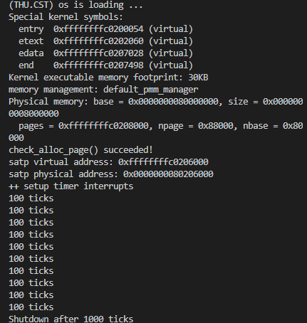
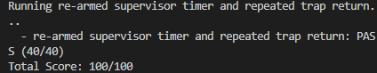

# 操作系统实验报告

## 实验基本信息

| 项目 | 内容 |
|---|---|
| **实验名称** | Lab 3：中断与异常处理 |
| **小组成员** | 2411353-李行阳、2412195-邵毅、2412352-王治中 |
| **完成日期** | 2026-11-08 |

### 小组分工

| 成员 | 负责的练习/模块 |
|---|---|
| 2411353-李行阳 | 功能模块一及报告中对应内容 |
| 2412195-邵毅 | 功能模块二（异常）及报告中对应内容 |
| 2412352-王治中 | 功能模块二（中断）及报告中对应内容 |

实验报告分工上，各自完成自己负责的模块并撰写可直接整合的内容，之后共同讨论整体性要求。

---

## 一、实验目的

Lab 2 完成物理内存管理后，内核面对时钟、断点、非法指令仍没有统一的响应入口，本实验的任务就是补上它。

本实验的主要目的是：

1. 理解 RISC-V 的中断、异常与 trap 机制（特权级、CSR、委托、`sret`）。
2. 掌握 Trap 上下文的保存与恢复，理解 `trapframe` 的布局和 `SAVE_ALL/RESTORE_ALL` 的对称关系。
3. 掌握时钟中断、断点异常和非法指令异常的处理方法。
4. 练习用提示词让 AI 生成汇编/C 代码，并用测试验证生成结果。
5. 理解中断关闭/开启与临界区的基本思想。

具体地，本实验需要完成：

- 在 `kern/trap/trapentry.S` 中实现 `RESTORE_ALL`，并补全 `__alltraps` 的入口代码；
- 在 `kern/trap/trap.c` 中实现 `interrupt_handler()` 与 `exception_handler()`；
- 通过 `make grade` 中所有测试点，验证上下文恢复、异常返回和持续时钟中断。

---

## 二、实验环境

| 成员 | AI 编程工具 | 底层模型 | 备注 |
|---|---|---|---|
| 2411353-李行阳 | Claude Code（终端） | DeepSeek-V4.1-flash | |
| 2412195-邵毅 | DeepSeek Harness（Web UI） | DeepSeek-flash | |
| 2412352-王治中 | DeepSeek Harness | DeepSeek-flash | |

**说明：**

- **AI 编程工具**：指具体使用的终端工具、编辑器插件、桌面应用或浏览器界面
- **底层模型**：指该工具使用的大语言模型及版本

---

## 三、实验整体逻辑分析

### 3.1 本章节的逻辑主线

Lab 2 已经让内核能够管理物理内存，但内核仍然是一个“只会顺序执行”的程序：时钟到来、断点、非法指令这些事件发生时，系统没有统一的入口去接管。本实验要建立的就是这个入口，以及围绕它的“进入—处理—返回”闭环。

整个实验围绕一条主线展开：**硬件在 trap 发生时把 PC 跳到 `stvec` 指向的入口，入口先把当前 CPU 现场保存成一个 `trapframe`，再按调用约定把 `trapframe` 交给 C 函数 `trap()`；`trap()` 根据 `scause` 把中断或异常分发给对应处理函数；处理完成后，入口代码从 `trapframe` 恢复现场，最后用 `sret` 回到被打断的指令。**

本章逻辑：**入口与上下文恢复（模块一）→ 中断/异常分类处理（模块二）→ 统一的返回路径**。

### 3.2 功能的逐步实现

1. **配置 trap 入口**：`idt_init()` 把 `__alltraps` 的地址写入 `stvec`，并把 `sscratch` 清零。完成后，任何 trap 都会跳到 `__alltraps`。
2. **保存现场**：`SAVE_ALL` 在栈上分配 36 个 8 字节槽位（共 288 字节）的 `trapframe`，保存 32 个通用寄存器和 `sstatus/sepc/sbadaddr/scause`。
3. **实现入口与恢复（模块一）**：`__alltraps` 把 `sp` 作为参数传给 `trap()`；`RESTORE_ALL` 按相反顺序恢复现场（除了**sp最后恢复**）。`RESTORE_ALL` 的**槽位顺序必须与 `trapframe` 定义一一对应**。
4. **分发处理**：`trap()` 调用 `trap_dispatch()`，根据 `scause` 最高位区分中断和异常，分别进入 `interrupt_handler()` 或 `exception_handler()`。
5. **实现中断/异常处理（模块二）**：时钟中断重装下一次时钟并累计 `ticks`；断点和非法指令打印信息并推进 `epc`；未知类型用 `print_trapframe()` 兜底。
6. **触发与验证**：`clock_init()` 设置第一个时钟事件，`intr_enable()` 置位 `sstatus.SIE`，内核开始响应中断；随后系统持续收到时钟中断，`make grade` 用三个测试验证整条链路。

与 trap 直接相关的简化调用链：

```text
kern_init()
  → idt_init()                 // stvec = __alltraps
  → clock_init()               // sie.STIE, 第一次时钟
  → intr_enable()              // sstatus.SIE = 1
  → 时钟中断
  → __alltraps                 // SAVE_ALL
  → trap(tf) → trap_dispatch(tf)
  → interrupt_handler(tf) / exception_handler(tf)
  → __trapret → RESTORE_ALL → sret
```

---

## 四、实验内容与实现

本章的两个功能模块分别对应“进入 trap 前后如何保存/恢复现场”和“进入 C 之后如何处理中断/异常”。

### 功能模块一：Trap 上下文恢复与 Trap 入口

**负责人：** 2411353-李行阳

#### 模块功能描述

本模块涉及 `kern/trap/trapentry.S` 中的两处：

```asm
.macro RESTORE_ALL
    ...
.endm

__alltraps:
    SAVE_ALL
    ...
```

- **`RESTORE_ALL`**（`trapentry.S:59-107`，宏声明在 57、`.endm` 在 109）：从当前栈上的 `trapframe` 恢复 31 个通用寄存器（`x0` 硬连线为 0，跳过）和 4 个 CSR（`sstatus`、`sepc`、`sbadaddr`、`scause`），最后恢复 `sp`。
- **`__alltraps` 的入口代码**（`trapentry.S:116-120`）：在 `SAVE_ALL` 之后，把当前 `sp`（即 `trapframe` 基址）作为第一个参数放入 `a0`，调用 `trap(struct trapframe *tf)`；返回后顺序落入框架的 `__trapret`。

**作用：** 把硬件保存的现场转成 C 函数能读写的结构体，并在处理完成后把现场原样还回去。没有它，`trap()` 拿不到上下文，`sret` 也无法回到正确的执行状态。

**主要场景：** 时钟中断、断点异常、非法指令异常，以及所有需要从 S 模式 trap 返回的路径。

**与其他模块的交互：**

- 与 `SAVE_ALL` 严格镜像：槽位 0～31 是 `x0`～`x31`，槽位 32～35 是四个 CSR；槽位 2 存的是“分配 trapframe 之前的 sp”。
- 与 `trap()` 通过 RISC-V 调用约定交互：`a0` 是第一个参数，`jal trap` 写 `ra`，但原 `ra` 已保存在 `trapframe` 中，返回时由 `RESTORE_ALL` 恢复。
- 与 `__trapret` 顺序衔接：`jal trap` 返回后没有跳转指令，控制流直接落到 `__trapret` 的 `RESTORE_ALL`。

实现上最关键的三点是：

1. **CSR 先恢复**：`csrw` 必须经由通用寄存器，而这时所有通用寄存器都还没恢复，正好借用 `s1～s4` 作为临时寄存器；它们的原值在槽位 9、18、19、20，后面会重新加载。
2. **`x0` 跳过，`x2` 特殊**：`x0` 写入无效；`x2(sp)` **既是被恢复的值，又是访问 `trapframe` 的基址**，必须最后恢复。
3. **`sp` 最后恢复**：上面的所有 `LOAD` 都以旧 `sp` 为基址，提前恢复 `sp` 会让后续加载全部错位。

#### 最终提示词

本模块的 spec 从框架已有的 `SAVE_ALL` 布局和 RISC-V 调用约定反推而来，按四段式编写。最终使用的提示词如下：

```text
[PROMPT]
在 ucore-riscv 的 lab3 中实现 Trap 入口与上下文恢复功能：
1. 补全 kern/trap/trapentry.S 中的 RESTORE_ALL 宏；
2. 补全 __alltraps 中 SAVE_ALL 之后、__trapret 之前的入口代码。
直接修改源文件，给出完整实现，并说明如何用 make grade 的 Test 1 验证。

[RELY]
- struct trapframe 定义在 kern/trap/trap.h：共 36 个 uintptr_t，前 32 个依次是 x0~x31，后 4 个槽位依次保存 sstatus、sepc、sbadaddr、scause（结构体字段名为 status、epc、badvaddr、cause）。
- SAVE_ALL 已实现：csrw sscratch, sp；sp -= 36 * REGBYTES；保存 x0、x1、x3~x31；csrrw s0, sscratch, x0；csrr s1~s4 保存 4 个 CSR；STORE s0, 2*REGBYTES(sp)；STORE s1~s4, 32~35*REGBYTES(sp)。
- __trapret 已实现：RESTORE_ALL；sret。
- REGBYTES = 8；LOAD/STORE 分别展开为 ld/sd。
- void trap(struct trapframe *tf) 已实现，不需要修改。

[GUARANTEE]
- 只修改 RESTORE_ALL 宏体和 __alltraps 中 SAVE_ALL 之后的位置。
- 不修改 SAVE_ALL、struct trapframe、trap() 的签名。
- 不新增全局符号。

[SPECIFICATION]
RESTORE_ALL:
- Pre-Condition：sp 指向 SAVE_ALL 建立的完整 trapframe；当前为 S 模式；SIE = 0。
- Post-Condition：x1、x3~x31 和 sstatus/sepc/sbadaddr/scause 等于 trapframe 中对应槽位的值；sp 等于槽位 2 保存的原 sp；不修改 trapframe 以外的内存。
- Case：任意寄存器值（包括 0、全 1、等于 sp）都必须正确恢复。
- Requirements：x2(sp) 必须特殊处理；不得依赖任何寄存器进入前的值；CSR 写入借助的临时寄存器，其原值最终必须恢复；恢复 sstatus 不得在 sret 前意外打开中断。
__alltraps:
- Pre-Condition：SAVE_ALL 已执行，sp 指向 trapframe。
- Post-Condition：以 trapframe 地址为第一个参数调用 trap()；返回后 sp 不变，控制流进入 __trapret。
- Requirements：参数按 RISC-V ABI 放在 a0；不得破坏恢复所需的信息。
```

#### 实现迭代过程

本模块共 1 次生成迭代。

##### 第一次迭代

- **结果**：AI 按上述 spec 生成 `RESTORE_ALL` 和 `__alltraps` 入口代码；汇编通过，`__alltraps` 仍保持 4 字节对齐。
- **验证**：在 `/tmp` 副本中补上两个临时 handler 桩，用 QEMU 4.1.1 以 `GRADE_LAB3_CONTEXT` 单独运行 Test 1，结果为 **PASS 35/35**。
- **遇到的问题**：生成代码本身没有出现寄存器恢复类 bug；验证时遇到的是 lab3 讲义缺少部分 lab2 依赖，直接 `make` 会在物理内存目录链接失败。这与本模块逻辑无关；合并 lab2 实现后，整树可编译并进入 Test 1。
- **实现要点**：
  - `RESTORE_ALL` 先恢复 CSR，再恢复通用寄存器，**最后恢复 `sp`**；
  - 借用 `s1~s4` 恢复 CSR 后，从槽位 9/18/19/20 重新加载它们的原值；
  - `__alltraps` 只增加 `mv a0, sp` 与 `jal trap` 两条指令，其余交给框架的 `__trapret`。

**最终结果：**

- ✅ 汇编通过，`__alltraps` 4 字节对齐；
- ✅ Test 1 PASS（35/35）；
- ✅ 反汇编结构与 `SAVE_ALL` 的布局类似。

---

### 功能模块二：中断与异常处理

**负责人：** 2412195-邵毅（异常处理）、2412352-王治中（中断与时钟）

#### 模块功能描述

本模块涉及 `kern/trap/trap.c` 中的两个函数：

```c
void interrupt_handler(struct trapframe *tf);   // trap.c:88-144
void exception_handler(struct trapframe *tf);   // trap.c:154-170
```

`trap_dispatch()`（`trap.c:172-180`）在 `tf->cause` 最高位为 1 时调用 `interrupt_handler()`，否则调用 `exception_handler()`。两个函数不直接写 CSR，**只通过 `trapframe` 影响返回状态**：`interrupt_handler()` 不修改 `tf`，`exception_handler()` 只修改 `tf->epc`；返回后由 `__trapret` 的 `RESTORE_ALL` 把 `tf->epc` 等写回 CSR，再执行 `sret`。

**中断处理：**

- **中断原因识别**：`scause` 最高位是中断标志，低位是中断号。实现先清除最高位，再匹配 `IRQ_*`：
  `uintptr_t cause = tf->cause & ~((uintptr_t)1 << (sizeof(uintptr_t) * 8 - 1));`
- **时钟中断（`IRQ_S_TIMER`）**：先调用 `clock_set_next_event()` 重装下一次时钟，再执行 `ticks++`；每 `TICK_NUM`（100）次调用 `print_ticks()` 输出一行 `100 ticks`；累计到 `SHUTDOWN_AFTER * TICK_NUM` 时输出关机提示并调用 `sbi_shutdown()`。
- **其他中断**：已定义类型只输出类型提示；未知中断输出 `Unknown interrupt: cause %d` 后调用 `print_trapframe(tf)`。

**异常处理：**

- **非法指令/断点**：输出 `Illegal instruction at ...` / `Breakpoint at ...`，然后**按指令长度推进** `tf->epc`。
- **指令长度**：读取 `tf->epc` 处的 16 位半字，低两位为 `0b11` 表示 32 位指令（偏移 +4），否则为 16 位压缩指令（偏移 +2）。
- **其他异常**：只调用 `print_trapframe(tf)` 兜底，不修改 `tf->epc`。

**关键点：**

1. **改 `tf->epc`，不改 `sepc`**：`RESTORE_ALL` 会用 `trapframe` 中的 `epc` 覆盖 `sepc`；直接写 `sepc` 会被恢复流程覆盖，达不到跳过异常指令的效果。
2. **时钟必须重装**：`clock_set_next_event()` 设置的是一次性事件；不重装，**系统只会收到一次时钟中断**。先重装再输出/关机，可以减少延迟，并保证重装不会被后续路径跳过。
3. **`SHUTDOWN_AFTER` 是本次新增的宏**：原始代码框架未定义（讲义只把它列为应使用的宏）；实现中在 `trap.c` 顶部增加 `#define SHUTDOWN_AFTER 10`，表示累计 10 次 `100 ticks` 输出（1000 ticks）后关机。
4. **输出格式以 `grade.sh`/测试为准**：指导书只写“规定格式”，具体匹配串由 `tools/grade.sh` 给出（`Breakpoint at`、`Illegal instruction at`、`Supervisor software interrupt`、`Unknown interrupt: cause`、`cause    0x...`）。

#### 最终提示词

模块二的最终提示词如下：

~~~text
[PROMPT]
**任务**：修改 code/kern/trap/trap.c，实现 lab3 功能模块二“中断与异常处理”，完成 interrupt_handler() 和 exception_handler() 两个函数。interrupt_handler() 负责对 Trap 入口送来的中断按原因分类处理；exception_handler() 负责对同步异常分类处理。两个函数处理结束后都必须返回到 trap_dispatch()/trap()，由已有的 Trap 返回流程恢复现场并执行 sret。

**操作要求**：必须实际修改项目文件，不要只展示代码。保留 trap.c 中已有代码和注释，只在标有 `//lab3 function2` 的位置补全两个函数；累计输出达到 SHUTDOWN_AFTER 后需要调用框架提供的关机接口，`SHUTDOWN_AFTER`在 trap.c 顶部新增宏定义。不得修改两个函数的签名，不得修改 trap.c 中规定以外的其他函数（包括 trap_dispatch()、trap()、print_trapframe()、print_regs()、print_ticks()、idt_init()、trap_in_kernel() 等），不得改动 trapentry.S、trap.h 中的现有接口和数据结构。如需辅助函数，应声明为 static，仅供本模块内部使用。

**输出要求**：直接进行文件操作；实现必须使用下面 [RELY] 中列出的、工程中真实存在的宏、结构体、全局变量和函数，不要引入无关功能或自造接口。

[RELY]
// 结构体与分流（code/kern/trap/trap.h、trap.c）
// struct trapframe （含 gpr、status、epc、badvaddr、cause 字段）；
// tf->cause 最高位为 1 表示中断、为 0 表示同步异常，trap_dispatch() 已按此分流到两个处理函数。

// 中断原因（code/libs/riscv.h）：IRQ_* 宏共 12 个（IRQ_U_SOFT=0 ~ IRQ_M_EXT=11），需特判 IRQ_S_TIMER=5。
// 异常原因（code/libs/riscv.h）：CAUSE_ILLEGAL_INSTRUCTION=0x2、CAUSE_BREAKPOINT=0x3。

// 时钟与统计：TICK_NUM=100（已有）、SHUTDOWN_AFTER 需新增、extern volatile size_t ticks（时钟中断计数）；
// void print_ticks(void)：输出一次统计信息；
// void clock_set_next_event(void)：设定下一次时钟事件，不调用则只能收到一次时钟中断（clock.h）；
// void sbi_shutdown(void)：关机，不返回（sbi.h）。

// 输出与调试（已有）：int cprintf(const char *fmt, ...)、void print_trapframe(struct trapframe *tf)（打印完整 Trap frame）。

// Trap 返回与指令长度：RESTORE_ALL 会把 tf->epc 等写回对应 CSR 后执行 sret，
// 因此改变返回地址应修改 tf->epc，不能直接写 sepc；
// 指令低两位为 0b11 时长度为 4 字节，否则为 2 字节（ebreak 4 字节，c.ebreak 2 字节）。

[GUARANTEE]
必须实现或修改的接口：
```c
void interrupt_handler(struct trapframe *tf);
void exception_handler(struct trapframe *tf);
```

可以根据需要添加：
- 静态辅助函数（建议声明为 static，例如用于判断异常指令长度）；
- 本模块内部使用的宏定义或静态变量。

不得改变上述公开接口，不得新增与实验无关的全局接口。

[SPECIFICATION]
## interrupt_handler

**Pre-Condition**:
- 由 trap_dispatch() 在 tf->cause 为中断（最高位为 1）时调用，tf 指向有效的 trapframe；返回后由统一的 Trap 返回流程恢复现场并执行 sret。

**Post-Condition**:
- 按去掉最高位后的中断原因完成对应处理并正常返回；每次时钟中断 ticks 恰好加 1，且下一次时钟事件已被重新设定；其他中断不改变 ticks、不重设时钟事件、不推进 tf->epc。

**Case 1**：去掉最高位后为 IRQ_S_TIMER。
- 先重新设定下一次时钟事件，再将 ticks 加 1；ticks 为 TICK_NUM 整数倍时输出一次统计信息；达到 SHUTDOWN_AFTER * TICK_NUM 时输出关机提示并关机（关机后不返回）。

**Case 2**：其他中断。
- 已定义的中断输出对应的中断类型提示；无法识别的按 `Unknown interrupt: cause %d` 的格式输出原因编号，并打印完整 Trap frame 辅助调试。

**Requirements**:
- 匹配 IRQ_* 宏前必须清除 cause 的最高位，不能把带符号的负 cause 直接用于分支；不修改 trapframe 中与中断处理无关的字段。

## exception_handler

**Pre-Condition**:
- 由 trap_dispatch() 在 tf->cause 为同步异常（最高位为 0）时调用；tf->epc 为触发异常的指令地址，且该指令在内存中可读。

**Post-Condition**:
- 非法指令和断点异常已按实验规定格式输出，且 tf->epc 已推进到下一条指令地址（必须结合指令编码判断长度，不得固定 +4）；其他异常已打印完整 Trap frame，且 tf->epc 保持不变；返回后不会重复执行触发异常的指令。

**Case 1**：CAUSE_ILLEGAL_INSTRUCTION 或 CAUSE_BREAKPOINT。
- 分别按 `Illegal instruction at 0x%08x` / `Breakpoint at 0x%08x` 的格式输出（参数为 tf->epc），按指令编码判断实际长度（c.ebreak 2 字节、ebreak 4 字节）并推进 tf->epc。

**Case 2**：其他异常原因。
- 打印完整 Trap frame 兜底；不修改 tf->epc 及其他字段，不实现实验未要求的恢复逻辑。
~~~

#### 实现迭代过程

本模块共 2 次迭代。

**第一次迭代：** 实现 `interrupt_handler()` / `exception_handler()` 主体，包括中断分类、时钟重装与计数、非法指令/断点输出与 `epc` 推进、未知类型兜底。

**第二次迭代：** 补充 `SHUTDOWN_AFTER` 累计关机逻辑，在每次 `print_ticks()` 之后判断 `ticks` 是否达到 `SHUTDOWN_AFTER * TICK_NUM`。

实现中遇到并解决了一个编译问题：

- **`SHUTDOWN_AFTER` 未定义**：第一次生成的代码在时钟分支里使用 `SHUTDOWN_AFTER`，但原始框架没有这个宏，编译报未定义。核对讲义后确认它只被列为“应使用的宏”，需要自己补充；在 `trap.c` 顶部增加 `#define SHUTDOWN_AFTER 10`，并补 `#include <sbi.h>` 以调用 `sbi_shutdown()`，之后编译通过。

**最终结果：**

- ✅ 两个函数编译通过；
- ✅ `make grade` 三个用例全部通过（100/100）；
- ✅ 功能符合预期。

---

## 五、测试与验证

### 5.1 `make qemu` 运行观察

`make qemu` 启动后先输出 `++ setup timer interrupts`，随后每 100 次时钟中断打印一行 `100 ticks`；持续运行到 1000 ticks 时输出 `Shutdown after 1000 ticks` 并关机，说明**时钟中断被持续重装**、关机路径生效：

```text
++ setup timer interrupts
100 ticks
100 ticks
100 ticks
100 ticks
100 ticks
100 ticks
100 ticks
100 ticks
100 ticks
100 ticks
Shutdown after 1000 ticks
```



*图 1：QEMU 4.1.1 下 `make qemu` 的运行输出。*

### 5.2 `make grade` 评分测试

`make grade` 会先 `make clean`，把源码复制到 `/tmp/lab3_grade`，由 `tools/inject.py` 注入 `tools/test_lab3.*` 并在 `kern_init()` 相应位置插入测试调用，再用 QEMU 4.1.1 逐一运行。

| 测试 | 验证内容 | 结果 |
|---|---|---|
| Test 1 | Trap 入口、寄存器恢复、断点 EPC | PASS 35/35 |
| Test 2 | 非法指令 EPC 推进、handler 兜底 | PASS 25/25 |
| Test 3 | 持续时钟中断与反复 Trap 返回 | PASS 40/40 |



*图 2：`make grade` 最终结果：Total Score 100/100，三个用例全部通过。*

---

## 六、实验总结与收获

### 对操作系统的理解

- **Trap 是硬件与内核的分界线**：硬件在 trap 发生时自动保存 PC、写入 `scause`、跳到 `stvec`；软件负责解释原因、处理事件、恢复现场。理解这条分界线，才能分清哪些事必须由硬件做、哪些事由内核做。
- **上下文恢复的核心是“布局一致”**：`SAVE_ALL`、`struct trapframe`、`RESTORE_ALL`、RISC-V 调用约定四者必须严格对应；任何一处假设了不同的槽位或寄存器顺序，都会在返回时表现为**寄存器错乱或原地死循环**。
- **机制与策略分离**：入口/恢复是通用机制，`trap_dispatch()` 只按 cause 分流，具体处理由 `interrupt_handler()` / `exception_handler()` 完成。新增一种中断或异常，**只需要在策略层增加分支，不必改入口**。

#### 本实验重要知识点及对应 OS 原理

| 本实验知识点 | 对应 OS 原理 | 含义、关系与差异 |
|---|---|---|
| trap / 中断 / 异常 | 中断与异常处理 | 中断是异步的，异常是当前指令同步触发的；trap 是二者的统一入口。本实验用同一个 `__alltraps` 处理两类事件。 |
| trapframe / 上下文保存恢复 | 进程上下文切换 | 本实验把寄存器保存到内核栈上的 `trapframe`；完整的进程切换还要切换页表、内核栈、PCB 等，范围更大。 |
| CSR / `stvec` / `sret` | 特权级与模式切换 | CSR 是 CPU 的控制/状态寄存器；`stvec` 决定 trap 入口，`sret` 按 `sepc` 和 `sstatus` 返回。OS 原理中对应“用户态/内核态切换”。 |
| 时钟中断 / `ticks` | 时钟与时间管理 | 本实验用 SBI 的一次性定时器 + 每次中断重装来模拟周期时钟；OS 原理中的时钟还负责时间片、超时和调度。 |
| `local_intr_save/restore` | 临界区 / 互斥 | 讲义介绍了这套接口；本实验的 trap 代码没有直接使用，临界区保护主要出现在物理内存分配路径。多核场景还需要自旋锁等机制。 |
| `epc` 指令长度 | 异常返回 / 指令集 | RISC-V 指令长度可变（16/32 位）；异常返回必须按实际长度跳过出错指令，否则会重复触发。 |

#### OS 原理中重要但本实验没有对应的知识点

- **进程/线程调度与上下文切换**：本实验是内核态自陷，没有进程切换和调度器。
- **用户态与系统调用**：本实验没有 U 模式；`ecall` 只用于 S 模式向 OpenSBI 请求服务，不是用户态系统调用。
- **缺页异常与按需分页**：lab2 建立了页表，但 lab3 没有处理缺页异常和页面置换。
- **多核同步与锁**：本实验是单核，关中断只影响当前 hart；多核共享数据需要锁和内存屏障。
- **文件系统、设备驱动、进程间通信**：本实验只覆盖 trap 机制本身。
- **Trap 委托（`medeleg/mideleg`）**：由 OpenSBI 在启动时配置，本实验未实现委托设置。

### AI 协作开发的经验

- **先把 spec 写成契约**：写清输入、输出、约束和边界，**而不是指令序列**；AI 可以自由选择实现，但必须满足可验证的条件。
- **用四段式提示词**：`[PROMPT]` 任务、`[RELY]` 最小可信上下文、`[GUARANTEE]` 接口、`[SPECIFICATION]` 行为规格。`[RELY]` 只给工程中已有的接口，避免 AI 猜测。
- **以测试结果为准**：`make grade` 的三个用例比“AI 说对了”可靠；Test 1 还反向验证了 `sepc` 恢复（异常处理推进 `tf->epc` 后，恢复出的 `sepc` 指向下一条指令）——如果 `RESTORE_ALL` 没恢复 `sepc`，`ebreak` 会反复执行，测试不可能通过。


