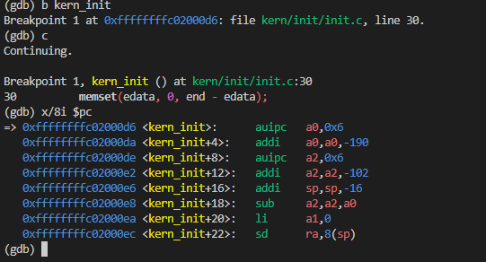
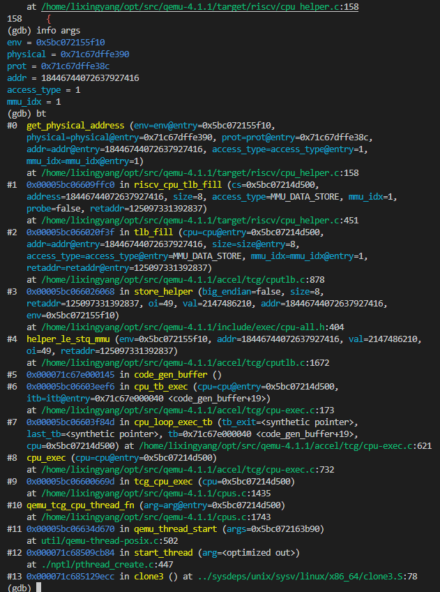
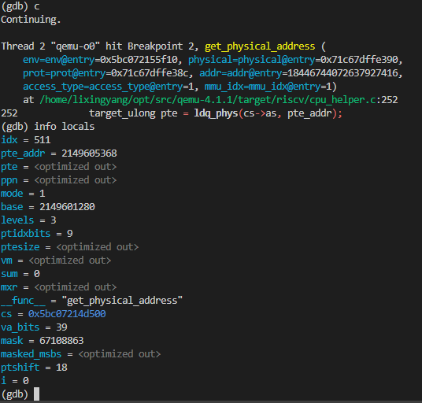
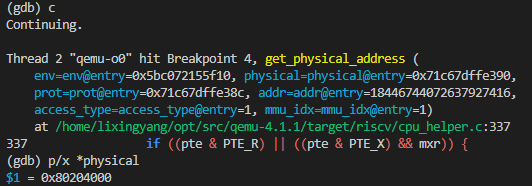
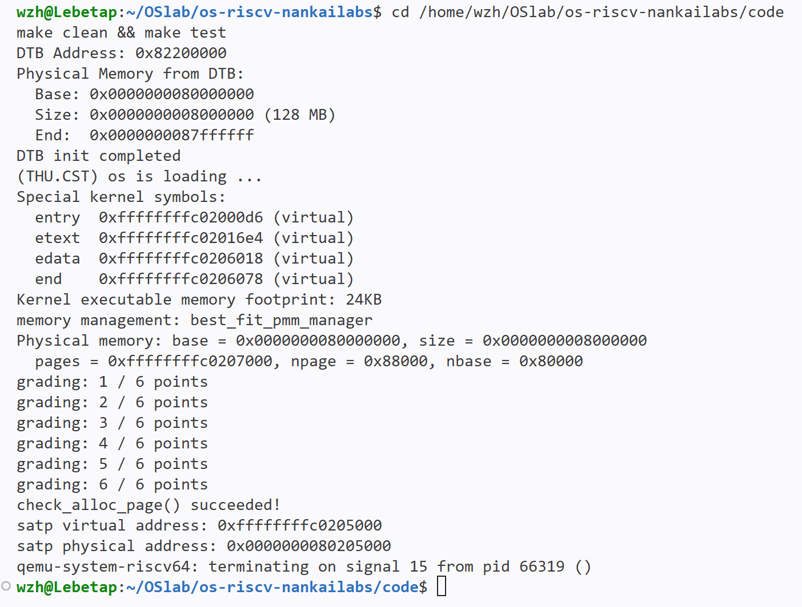
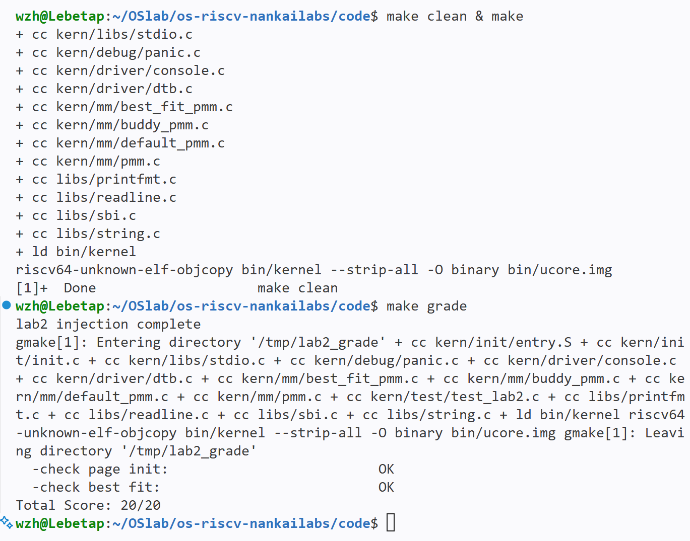
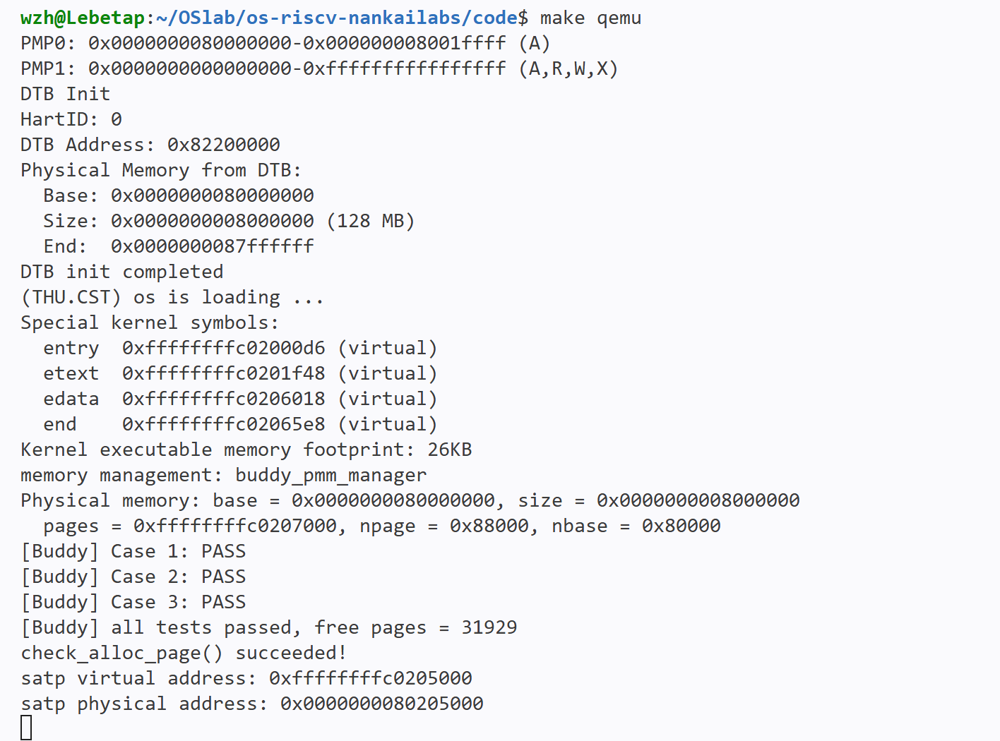

# 操作系统实验报告

## 实验基本信息

| 项目 | 内容 |
|---|---|
| **实验名称** | Lab 2：物理内存与页表 |
| **小组成员** | 2411353-李行阳、2412195-邵毅、2412352-王治中 |
| **完成日期** | 2026-10-25 |

### 小组分工

| 成员 | 负责的练习/模块 |
|---|---|
| 2411353-李行阳 | 功能模块一及其challenge、分支任务、报告整合与提交 |
| 2412195-邵毅 | 功能模块二challenge及报告中对应内容、合并代码 |
| 2412352-王治中 | 功能模块二除challenge及报告中对应内容 |

> 说明：实验报告上各自完成自己相应负责内容,可直接交付李行阳整合,之后共同讨论攥写整体性的实验报告要求内容。

---

## 一、实验目的

实验 1 结束时，我们已经得到一个可以启动的最小内核：CPU 加电后经过 OpenSBI，跳转到内核入口，进入 C 语言入口 `kern_init`。但此时内核对物理内存还没有真正的管理能力：它还没有开启分页，只能直接访问物理地址，也不知道哪些物理页可用、如何建立描述符、如何把空闲页交给分配器。

实验 2 主要涉及操作系统的物理内存管理。本实验在实验一的基础上，先发现系统中的物理内存，建立对物理内存的初步管理，再掌握页表相关操作，建立最简单的虚拟内存到物理内存的映射；最后通过分支任务观察 QEMU 如何模拟 TLB 查询和页表遍历。

本实验的主要目的是：

1. 理解物理内存的管理方法：内核如何从 DTB 获得物理内存范围，如何用 `struct Page` 描述符管理物理页，如何把空闲页交给 `pmm_manager`；
2. 理解页面分配算法：First-Fit、Best-Fit、Buddy System 以及 SLUB 的基本思想和差异；
3. 理解页表的建立和使用方法：SV39 页表、`satp`、虚拟地址到物理地址的转换，以及 TLB 在其中的作用；
4. 掌握用 GDB 观察 QEMU 地址翻译的方法，理解“软件模拟硬件”的过程；
5. 练习用提示词/规格驱动 AI 完成代码，并记录 AI 协作中的问题和解决过程。

具体地，本实验需要完成：

- 解析 DTB，获取物理内存的起始地址和大小；
- 实现 `page_init()`，建立 `Page` 描述符数组，排除 OpenSBI、内核镜像和描述符数组，把完整空闲页注册给 `pmm_manager`；
- 理解并实现 First-Fit / Best-Fit 等物理页分配算法，完成 Buddy System 任务和 SLUB 扩展任务（Challenge）；
- 通过分支任务，用双 GDB 观察一次访存指令的 VA→PA 翻译；
- 按报告要求记录 spec、prompt、AI 生成中的问题和解决过程。

---

## 二、实验环境

| 成员 | AI 编程工具 | 底层模型 | 备注 |
|---|---|---|---|
| 2411353-李行阳 | Claude Code（终端） | DeepSeek-V4.1-flash | qemu版本已由lab1的8.2.2变为4.1.1来进行实验 |
| 2412195-邵毅 | DeepSeek Harness（Web UI） | DeepSeek-flash | |
| 2412352-王治中 | DeepSeek Harness | DeepSeek-flash | |

**说明：**

- **AI 编程工具**：指具体使用的终端工具、编辑器插件、桌面应用或浏览器界面
- **底层模型**：指该工具使用的大语言模型及版本

---

## 三、实验整体逻辑分析

### 3.1 本章节的逻辑主线

Lab 1 结束时，内核已经能启动并按物理地址运行，但它对物理内存还没有管理能力：它不知道内存从哪里开始、有多大，也不知道哪些页已经被 OpenSBI 和内核自身占用。Lab 2 的主线，就是让内核先“知道”物理内存，再“管理”物理内存，最后通过调试理解 Lab 2 启动代码建立的虚拟地址映射。

**先要知道内存在哪里。** OpenSBI 在启动时扫描硬件，把物理内存的起点和大小写进 DTB；内核读取 DTB，得到后续管理所需的物理内存范围。没有这一步，后面的页描述符和分配器都无从谈起。

**再要确定哪些页能用。** 内核为每个物理页建立一个页描述符，形成连续的描述符数组；先把 OpenSBI、内核镜像、描述符数组自身以及内存末尾不足一页的部分标为保留，只把剩下的完整页交给物理内存管理器。管理器把这些页组织成空闲页，之后分配和回收才有依据。

**最后要理解虚拟地址如何落到物理页上。** Lab 2 的 entry.S 建立了最简单的启动页表并开启 Sv39；本实验不重新实现页表，而是通过分支任务，用双 GDB 观察 QEMU 如何查 TLB、TLB miss 后如何遍历页表，最终把虚拟地址翻译成物理地址。这一部分是对已有页表机制的观察，不是物理内存管理主线的下一步。

因此，本章的逻辑主线可以概括为：先发现物理内存，再建立页描述符并划分保留区/空闲区，然后把空闲页交给分配器；分支任务作为一条观察线，帮助理解这些物理页如何通过页表被虚拟地址访问。

### 3.2 功能的逐步实现

本章按照“发现物理内存 → 建立页描述符并划分保留/空闲 → 交给分配器 → 观察页表翻译”的顺序逐步实现：

1. 首先实现**物理内存探测** → 为什么首先实现这个？因为后续所有页描述符和分配都依赖物理内存的起点和大小；没有 DTB 提供的内存范围，内核无法知道要管理哪些页。
2. 接着建立**页描述符并划分保留区/空闲区** → 为什么接着做这个？因为知道内存范围后，必须为每个物理页建立描述符，并把 OpenSBI、内核镜像、描述符数组自身和尾部碎页排除，否则分配器会把正在使用的内存分出去。
3. 然后完成**空闲页注册和分配算法** → 为什么然后做这个？因为只有把完整空闲页交给 `pmm_manager`，`alloc_pages()` / `free_pages()` 才有可分配的资源；First-Fit、Best-Fit、Buddy System、SLUB 是不同分配策略。

这三步在代码中的调用关系是：`kern_init() → dtb_init() → pmm_init() → init_pmm_manager() → page_init() → init_memmap() → alloc_pages()/free_pages()`。

以上三步是物理内存管理的实现主线。除此之外，分支任务用双 GDB 观察 Lab 2 启动代码建立的 Sv39 页表的地址翻译：它不改变实现顺序，而是帮助理解虚拟地址如何通过 TLB 和页表落到物理页上，形成从物理内存管理到虚拟内存映射的完整认识。

---

## 四、实验内容与实现

实验二主要涉及操作系统的物理内存管理。实验一已经得到一个可以启动的系统；本实验在此基础上，先发现系统中的物理内存，建立对物理内存的初步管理（连续物理内存管理），再掌握页表相关操作，建立最简单的虚拟内存到物理内存的映射；最后通过分支任务观察 QEMU 如何模拟 TLB 查询和页表遍历。

本实验的内容可以分成三条主线：物理内存的发现与描述符布局、物理页分配算法，以及用 GDB 观察页表翻译。下面按功能模块和任务展开。

### 功能模块：物理内存探测与页描述符初始化（page_init）

**负责人：** 2411353-李行阳

#### 模块功能描述

**需要实现/修改的函数：**

```c
static void page_init(void);
```

**功能说明：**

`page_init()` 由 `pmm_init()` 调用，把 DTB 报告的物理内存变成可管理的页描述符布局：

- 从 `get_memory_base()` / `get_memory_size()` 取内存范围，无效则 `panic()`；
- 设置 `va_pa_offset = PHYSICAL_MEMORY_OFFSET`，`npage = PPN(mem_end)`；
- `pages = ROUNDUP((uintptr_t)end, PGSIZE)`，描述符数组覆盖 `[nbase, npage)`；
- 先把描述符全部置 reserved，排除 OpenSBI、内核镜像、描述符数组和尾部碎页；
- 只把 `[ROUNDUP(PADDR(pages) + (npage - nbase) * sizeof(struct Page), PGSIZE), ROUNDDOWN(mem_end, PGSIZE))` 中的完整页交给 `init_memmap()`；
- 没有完整空闲页时不调用 `init_memmap()`。

核心状态和边界对应 `test_page_init()` 的 8 项检查：`va_pa_offset`、`npage`、`pages` 对齐/位置、空闲页数、内核尾页/数组页保留、`page2pa/pa2page` 往返。完整行为规格见下方 prompt。

#### 最终提示词

本任务的 prompt 采用四段式：`[PROMPT]` 任务、`[RELY]` 可信上下文、`[GUARANTEE]` 接口清单、`[SPECIFICATION]` 行为规格。核心原则是“写需要满足什么，而不是按步骤写实现”；每一条要求都能对应到测试、断言或状态检查。

完整 prompt 如下：

````text
[PROMPT]
任务：直接修改工程文件，完成 lab2 功能模块一任务一：物理内存探测与页描述符初始化。
目标文件：kern/mm/pmm.c。
实现位置：标有 `//lab2 function1 YOUR CODE` 的位置。
要求：
- 必须实际修改项目文件，不要只在回答里展示代码；
- 保留已有代码和注释，只补全 page_init；
- 不得修改框架测试/断言函数、已有数据结构、宏、头文件接口和结构体；
- 实现后必须能通过 check_alloc_page() 和官方 test_page_init() 的检查。

[RELY]
以下上下文均来自当前工程，不要改名或臆造：
- PGSIZE = 4096，PPN(x) = (uintptr_t)(x) >> PGSHIFT；
- struct Page 包含 ref、flags、property、page_link；
- PHYSICAL_MEMORY_OFFSET = 0xFFFFFFFF40000000，DRAM_BASE = 0x80000000，nbase = DRAM_BASE / PGSIZE；
- 全局变量：struct Page *pages; size_t npage; uint64_t va_pa_offset;；
- uint64_t get_memory_base(void); uint64_t get_memory_size(void); 返回 DTB 报告的物理内存范围；
- extern char end[]; 是内核镜像末尾的虚拟地址；
- PADDR(kva) 把内核虚拟地址转为物理地址；pa2page(pa) 把物理地址转为 Page 描述符指针；
- init_memmap(struct Page *base, size_t n) 把 n 个连续空闲页交给当前 pmm_manager；
- SetPageReserved(page) 设置保留标志；可用 panic()、cprintf()。

[GUARANTEE]
- 必须实现 static void page_init(void);；
- 如需要辅助函数，只能声明为 static，不得改动任何公开接口；
- 成功后必须正确设置 va_pa_offset、npage、pages。

[SPECIFICATION]
Pre-Condition:
- init_pmm_manager() 已执行，DTB 信息已就绪。

Post-Condition:
- va_pa_offset == PHYSICAL_MEMORY_OFFSET；
- npage == PPN(get_memory_base() + get_memory_size())，且 npage > nbase；
- pages == ROUNDUP((uintptr_t)end, PGSIZE)，描述符数组覆盖 [nbase, npage)；
- 注册空闲区前，所有描述符先置为 reserved；
- 只把完整空闲页区间注册给 init_memmap()：
  起点 = ROUNDUP(PADDR(pages) + (npage - nbase) * sizeof(struct Page), PGSIZE)，
  终点 = ROUNDDOWN(mem_base + mem_size, PGSIZE)；
- 输出探测到的物理内存范围。

Cases:
1. DTB 返回的 base 或 size 为 0：panic() 终止；
2. npage <= nbase：panic() 终止；
3. 空闲区起点 >= 终点：不调用 init_memmap()；
4. 内存末端非页对齐：向下取整，尾部不足一页不注册；
5. 正常情况：按 Post-Condition 注册空闲页。

Requirements:
- 区分虚拟地址、物理地址、物理页号、Page 描述符地址；
- 确保 OpenSBI 占用区、内核镜像、描述符数组都不进入空闲区；
- 写功能与状态，不要输出逐步伪代码。
````

这样写的核心是：先说明功能边界和可验证的前置/后置/分支条件，再给最小可信依赖；不写逐步伪代码，也不把提交规则混进模块 prompt。

#### 实现迭代过程

**第一次迭代**

按当前四段式 prompt，在干净骨架副本（`7301f54` 的 `pmm.c`）上生成 `page_init`，编译一次通过；注入 `test_page_init()` 后运行，`[Test 1] Page Init: PASS`、`check_alloc_page() succeeded!`，无需第二次修改。

> 该副本使用骨架自带的 `default_pmm_manager`，所以 `[Test 2] Best-Fit` 按预期 FAIL，不参与模块一验收。

### Challenge：OS 如何获取可用物理内存范围

**负责人：** 2411353-李行阳

OS 不能提前知道内存范围，我认为可取的思路有让“比 OS 更早启动的软件”把内存情况交给它或者让它在启动时去主动获取：

- **有标准固件/引导接口时**：RISC-V 由 OpenSBI 通过 DTB 告诉内核（本实验）；x86 由 BIOS e820 或 UEFI `GetMemoryMap()` 提供；服务器/虚拟机还可能由 ACPI 表或 hypervisor 配置。
- **没有标准接口时**：内核只能自己探测内存控制器或尝试访问内存，但可能触发总线错误、覆盖固件数据，通常只作最后手段。

本实验属于第一种：QEMU + OpenSBI 已经准备好 DTB，内核只需解析 `/memory`，再把可用页交给 `page_init()`。

---

### 练习：理解 First-Fit

**负责人：** 2412352-王治中

#### 1. First-Fit 的工作过程

First-Fit 用一条按页地址升序排列的空闲链表管理内存。每个空闲块只在链表中登记头页，头页的 `property` 记录块大小；因此从头遍历链表，第一个“够大”的块就是地址最低的满足块。

**（1）初始化空闲页（`default_init` / `default_init_memmap`）**

```c
static void
default_init(void) {
    list_init(&free_list);
    nr_free = 0;
}

static void
default_init_memmap(struct Page *base, size_t n) {
    struct Page *p = base;
    for (; p != base + n; p++) {
        assert(PageReserved(p));
        p->flags = p->property = 0;
        set_page_ref(p, 0);
    }
    base->property = n;
    SetPageProperty(base);
    nr_free += n;

    if (list_empty(&free_list)) {
        list_add(&free_list, &(base->page_link));
    } else {
        list_entry_t *le = &free_list;
        while ((le = list_next(le)) != &free_list) {
            struct Page *page = le2page(le, page_link);
            if (base < page) {
                list_add_before(le, &(base->page_link));
                break;
            } else if (list_next(le) == &free_list) {
                list_add(le, &(base->page_link));
            }
        }
    }
}
```

- `default_init`：初始化空链表，并把空闲页计数清零。
- `assert(PageReserved(p))`：这些页由 `page_init` 标为保留页，确认后才交给分配器。
- `p->flags = p->property = 0` 与 `set_page_ref(p, 0)`：清除保留位、旧块大小和引用计数，使页可用。
- `base->property = n`、`SetPageProperty(base)`：把连续 n 页看成一个空闲块；只有头页记录大小，并带有“空闲块头”标志。
- `nr_free += n`：总空闲页数增加 n。
- 插入时保持地址升序：空表用 `list_add`；否则找到第一个地址更大的块，用 `list_add_before` 插到它前面；若已到表尾，则用 `list_add` 追加。地址有序是“取低地址块”和“前、后邻合并”的基础。

**（2）分配连续页（`default_alloc_pages`）**

核心代码如下：

```c
if (n > nr_free)
    return NULL;

struct Page *page = NULL;
list_entry_t *le = &free_list;
while ((le = list_next(le)) != &free_list) {
    struct Page *p = le2page(le, page_link);
    if (p->property >= n) {
        page = p;
        break;
    }
}
```

- `n > nr_free`：总空闲页数都不够，直接返回 `NULL`。
- 从表头逐块比较，遇到第一个 `property >= n` 的块就停止。因为链表按地址升序，这个块就是地址最低的满足块，这正是 First-Fit 的选块方式。

```c
if (page != NULL) {
    list_entry_t *prev = list_prev(&(page->page_link));
    list_del(&(page->page_link));
    if (page->property > n) {
        struct Page *p = page + n;
        p->property = page->property - n;
        SetPageProperty(p);
        list_add(prev, &(p->page_link));
    }
    nr_free -= n;
    ClearPageProperty(page);
}
return page;
```

- `prev`：先记住前驱，拆分后要把余量插回原来的位置。
- `page + n`：从原块的第 n 页开始作为余量块。
- 余量块大小改为“原大小减 n”，重新设置空闲块头标志，并插回 `prev` 后面，链表仍按地址升序。
- `nr_free -= n`：只扣除实际分配的页数，余量仍算空闲。
- `ClearPageProperty(page)`：返回给调用者的块头不再具有“空闲块头”标志。

**（3）回收与合并（`default_free_pages`）**

逐页校验并按地址插入空闲链表之后，执行前、后邻合并的核心代码如下：

```c
base->property = n;
SetPageProperty(base);
nr_free += n;
/* 按页地址升序把 base 插入 free_list */

list_entry_t *le = list_prev(&(base->page_link));
if (le != &free_list) {
    struct Page *p = le2page(le, page_link);
    if (p + p->property == base) {
        p->property += base->property;
        ClearPageProperty(base);
        list_del(&(base->page_link));
        base = p;
    }
}

le = list_next(&(base->page_link));
if (le != &free_list) {
    struct Page *p = le2page(le, page_link);
    if (base + base->property == p) {
        base->property += p->property;
        ClearPageProperty(p);
        list_del(&(p->page_link));
    }
}
```

- 回收前逐页检查 `!PageReserved(p) && !PageProperty(p)`，确认这些页已经分配、且不在空闲链表中，然后清空标志并重置引用计数。
- 将 n 页重新组成一个空闲块：头页记录大小、设置空闲标志，`nr_free` 增加 n，再按地址升序插回链表。
- **前邻合并**：若前一个空闲块 `p` 满足 `p + p->property == base`，说明两块地址连续，把 `base` 并入 `p`；合并后的块头是低地址的 `p`，并摘除 `base` 的链表节点。
- **后邻合并**：若 `base + base->property == p`，说明 `base` 的末尾正好接上后一个块 `p`，把 `p` 并入 `base`，并摘除 `p` 的链表节点。
- 因为链表有序、且相邻空闲块已经合并，所以只需检查前、后各一个块。

**（4）复杂度**

- 分配：线性扫描空闲链表 O(m)，拆分 O(1)；
- 回收：按地址插入 O(m)，前后合并 O(1)；
- 其中 m 为空闲块的数量。

#### 2. 问题解答：原有的 First-Fit 算法是否有改进空间？

有，较直接的改进方向有以下三点：

1. **缩短查找范围**：分配时从链表头逐个比较，空闲块较多时效率不高。可以按块的大小分组，把大小相近的块放在同一条链表中，查找时先进入合适的大小组；也可以把空闲块组织成按大小排序的平衡树，直接定位到合适的块。这样能减少需要比较的块数。
2. **避免总是使用低地址**：First-Fit 每次都从最低地址开始找，低地址区域容易被切碎。可以记住上一次分配的位置，下次从该位置之后继续查找（Next-Fit），使空闲块的使用更均匀。

### 功能模块：Best-Fit 物理内存分配

**负责人：** 2412352-王治中

#### 模块功能描述

**需要实现/修改的函数：**

```c
static void best_fit_init(void);
static void best_fit_init_memmap(struct Page *base, size_t n);
static struct Page *best_fit_alloc_pages(size_t n);
static void best_fit_free_pages(struct Page *base, size_t n);
static size_t best_fit_nr_free_pages(void);
const struct pmm_manager best_fit_pmm_manager;
```

**功能说明：**

- **作用**：以 best-fit 策略管理页级物理内存，分配时从所有空闲块中选择能容纳请求的最小块，尽量把大块留给后续大请求；它是 `struct pmm_manager` 的另一种实现，用于替换默认的 First-Fit。
- **主要场景**：
  - 系统启动、`page_init()` 注册可用物理页时：把空闲区按页地址升序建成初始空闲链表；
  - 运行期申请 n 页且存在满足条件的块时：选取“够用的最小块”，余量在块尾切分成新的空闲块；
  - 申请时没有满足条件的块：返回 `NULL`，不改动空闲链表；
  - 释放一段页面时：按地址插回空闲链表，并在与前、后邻块地址连续时合并；
  - 框架查询空闲页数或执行自检时：返回总空闲页数，或运行 `best_fit_check()` 校验。
- **交互关系**：`page_init()` 通过 `init_memmap()` 注册空闲区；`alloc_pages()/free_pages()` 经 `pmm_manager` 函数指针转发到本模块；块大小和链节点复用 `struct Page` 的 `property`、`page_link`，`free_area_t` 维护 `free_list/nr_free`。

#### 最终提示词

````text
[PROMPT]
**任务**：修改 kern/mm/best_fit_pmm.c 的 lab2、YOUR CODE 处，实现 Best-Fit 管理器并定义 best_fit_pmm_manager；在 kern/mm/pmm.c 的 init_pmm_manager() 中将当前物理内存管理器切换为best_fit_pmm_manager

**操作要求**：你必须在项目中修改实际文件，保留现有代码，不得改动两个测试函数。

**输出要求**：直接进行文件操作。

[RELY]
// 宏与结构
PGSIZE；SetPageProperty / ClearPageProperty / PageProperty；struct Page；free_area_t
// 可用函数
list_add_before / list_del / list_next；pages、npage、nbase
// 测试函数直接用 free_list、nr_free，须在本文件自行提供

[GUARANTEE]
```c
static void best_fit_init(void);
static void best_fit_init_memmap(struct Page *base, size_t n);
static struct Page *best_fit_alloc_pages(size_t n);
static void best_fit_free_pages(struct Page *base, size_t n);
static size_t best_fit_nr_free_pages(void);
const struct pmm_manager best_fit_pmm_manager;
```

[SPECIFICATION]
## best_fit_init_memmap
**Post-Condition**: 头页记录块页数并置标志，计数加 n，按页地址升序入链。

## best_fit_alloc_pages
**Post-Condition**: 取页数不小于 n 的最小块，同大小取低地址；余量切分成新块，无块可满足返回 NULL。

## best_fit_free_pages
**Post-Condition**: 按页地址升序插入，再与前、后相邻空闲块合并。
````

#### 实现迭代过程

经过 1 次迭代，该模块最终：

- ✅ 编译通过
- ✅ 所有相关测试通过
- ✅ 功能符合预期

#### 改进空间

**问题解答：你的 Best-Fit 算法是否有进一步的改进空间？**

有，主要可以从以下三点改进：

1. **缩小查找范围**：当前分配需要扫描整条空闲链表，才能确定最小的够用块。可以把大小相近的块分到不同的链表中，先查合适的大小组；也可以把空闲块组织成按大小排序的平衡树，直接找到最小的够用块。这样能减少比较次数。
2. **减少小碎块**：Best-Fit 容易留下很小的余量，之后很难再使用。可以设置一个最小切分大小，当余量太小时，就把整块分配给请求。
3. **降低回收插入的开销**：回收时仍要按地址线性查找插入位置；与按大小分组的链表配合，可以缩短每条链表的长度，减少插入时的比较。

### 功能模块：Buddy System

**负责人：** 2412352-王治中

#### 模块功能描述

**需要实现/修改的函数：**

```c
static void buddy_init(void);
static void buddy_init_memmap(struct Page *base, size_t n);
static struct Page *buddy_alloc_pages(size_t n);
static void buddy_free_pages(struct Page *base, size_t n);
static size_t buddy_nr_free_pages(void);
static void buddy_check(void);
const struct pmm_manager buddy_pmm_manager;
```

**功能说明：**

- **作用**：按 2 的幂管理物理页，每阶维护一条按地址升序的空闲块链表。分配时向上取整到 2^k 并逐级分裂，回收时按页号异或定位同阶伙伴并逐级合并，合并路径短且无需扫描全表。
- **主要场景**：
  - 系统启动、注册空闲区时：空闲区起点通常不满足大阶对齐，按“起点对齐”贪心切成若干 2^k 块并挂入对应阶；
  - 申请 n 页时：先把请求向上取整到 2^k；目标阶为空则从更高阶逐级分裂，低位交给调用者、高位留在低阶链；
  - 申请时所有不小于请求的阶都为空：返回 `NULL`；
  - 释放任意长度页面时：按对齐拆成若干 2^k 块，逐级与同阶伙伴合并；不互为伙伴的相邻块保持独立；
  - 框架查询统计或自检时：返回总空闲页数，或运行 `buddy_check()` 校验各阶链表与分裂/合并行为。
- **交互关系**：与 `pmm.c` 的 `pmm_manager` 接口对接，经 `init_memmap()/alloc_pages()/free_pages()` 被框架调用；用 `Page.property` 记录块大小、`PageProperty` 标识空闲块头、每阶 `free_area_t` 维护链表与计数。`MAX_ORDER = 16` 覆盖 128MB 的 2^15 个页，最高阶无可用块时返回 `NULL`，非 2 的幂请求存在向上取整的内部碎片。

#### 测试函数

**需要实现/修改的函数：**

```c
static void buddy_check(void);
// 测试辅助函数
static void buddy_check_lists(void);
static void buddy_order_stat(size_t order, size_t *blocks, size_t *pages);
static size_t buddy_block_count(size_t order);
static void buddy_take_snapshot(size_t *blocks, size_t *pages);
static void buddy_check_snapshot(const size_t *blocks, const size_t *pages,
                                 size_t total_free);
static struct Page *buddy_find_covering(struct Page *target);
```

**功能说明：**

- **作用**：在 `buddy_pmm.c` 内实现自测入口 `buddy_check()`；由 `pmm_init() → check_alloc_page() → pmm_manager->check()` 自动调用，用于验证伙伴分配器的分裂、合并与计数是否正确。
- **主要场景**：
  - 内核启动、`pmm_init()` 调用 `check_alloc_page()` 时：执行 `buddy_check()`，先逐阶检查链表的基本性质，并记录初始的空闲块分布；
  - 验证边界行为时：Case 1 覆盖非 2 的幂向上取整与耗尽后无块可分配；Case 2 覆盖无空闲页时对齐连续页合并、非伙伴页不合并；Case 3 覆盖逐页释放全部页后与初始分布一致；
  - 用例通过时：输出 `[Buddy] Case N: PASS`，全部结束时输出总空闲页数。
- **交互关系**：测试只读 `free_area[]`、`nr_free` 等状态，通过 `alloc_pages()/free_pages()/nr_free_pages()` 公共接口驱动分配器；每个用例通过则打印 `[Buddy] Case N: PASS`，全部结束时打印 `[Buddy] all tests passed, free pages = %lu`。

#### 最终提示词

王治中提供的实现 prompt：

````text
[PROMPT]
**任务**：从零生成伙伴系统分配模块，实现 2 的幂分块、分裂与伙伴合并并定义 buddy_pmm_manager；在 pmm.c 的 init_pmm_manager() 选它。

**操作要求**：你必须在项目中创建并修改实际文件，不得改动已有分配模块及其测试函数。

**输出要求**：直接进行文件操作。

[RELY]
// 宏与结构
PG_property；struct Page；free_area_t
// 可用函数
list_add_before / list_del / list_next；pages、nbase；alloc_pages

[GUARANTEE]
```c
static void buddy_init(void);
static void buddy_init_memmap(struct Page *base, size_t n);
static struct Page *buddy_alloc_pages(size_t n);
static void buddy_free_pages(struct Page *base, size_t n);
static size_t buddy_nr_free_pages(void);
static void buddy_check(void);
const struct pmm_manager buddy_pmm_manager;
```

[SPECIFICATION]
## buddy_init_memmap
**Post-Condition**: 按"起点对齐"贪心切成若干 2^k 块，按地址升序挂入对应阶。

## buddy_alloc_pages
**Post-Condition**: 取不小于 n 的最小阶块，不足则从更高阶逐级分裂、低位交出；无可用块返回 NULL。

## buddy_free_pages
**Post-Condition**: 逐级与同阶伙伴合并，摘链时扣减总空闲页数并清旧块头标志。
````

王治中提供的测试 prompt：

````text
[PROMPT]
**任务**：在伙伴系统模块的实现文件内写测试，入口 buddy_check

**操作要求**：你必须在项目中修改实际文件，不改被测函数与其它模块。

**输出要求**：直接进行文件操作。每个用例通过时打印一行 [Buddy] Case N: PASS，全部结束时打印 [Buddy] all tests passed, free pages = %lu

[RELY]
// 可访问状态
各阶链表与块数、总空闲页数等
// 可用函数
alloc_pages / free_pages / nr_free_pages；assert；cprintf

[GUARANTEE]
```c
static void buddy_check(void);
```

[SPECIFICATION]
## buddy_check
**Post-Condition**: 逐阶校验地址升序、按阶对齐、块页数之和等于总空闲页数；各阶分配释放往返后总数复原。

  **Case 1**: 分配到耗尽后无块可分配，非 2 的幂请求按向上取整处理。

  **Case 2**: 无空闲页时释放一段按阶对齐的连续页应合成更大阶的块，互不为伙伴的两页不得合并。

  **Case 3**: 逐页释放全部后，总数与各阶块数回到初始快照。
````

#### 实现迭代过程

##### 第一次迭代

**遇到的问题：**

- 问题1：由于提示词中没有显示要求，Buddy System通过测试时在终端没有任何明显的输出。

**问题解决策略：**

- 针对问题1，在 [PROMPT] 的“输出要求”中添加提示词：每个用例通过时打印一行 [Buddy] Case N: PASS，全部结束时打印 [Buddy] all tests passed, free pages = %lu

**最终结果：**

经过 2 次迭代，该模块最终：

- ✅ 编译通过
- ✅ 所有相关测试通过
- ✅ 功能符合预期

**关键改进点总结：**

1. 在 [PROMPT] 的“输出要求”中增加 `[Buddy] Case N: PASS` 与总结行，解决“测试通过但终端无输出”的问题。

---

#### 测试覆盖与有效性

**测试覆盖的核心行为与边界情况**

- **核心行为**：
  - 初始切分：空闲区按“起点对齐”贪心切成若干 2^k 块，按地址升序挂入对应阶；
  - 逐阶基本性质：地址升序、块头按阶对齐、`PageProperty` 与 `property` 正确、各阶块页数之和等于总空闲页数；
  - 分配：取不小于 n 的最小阶块，逐级分裂且低位交出，返回块对齐、计数正确减少；
  - 回收：任意长度拆成对齐块，逐级与同阶伙伴合并；
  - 分配后再释放：每个可达阶分配并释放一次后，各阶块数、各阶页数和总数都应恢复到初始值。
- **边界情况**：
  - Case 1：非 2 的幂请求向上取整（3→4、5→8）；从高阶到低阶耗尽全部空闲块后，`alloc_page()` 与 `alloc_pages(2/3)` 均返回 `NULL`；
  - Case 2：无空闲页时释放一段 2 阶对齐的连续 4 页，只生成一个 2 阶块；释放两个互不为伙伴的页（`b+4`、`b+6`）时保持两个 0 阶块、不发生合并；补齐后逐级合并为一个 3 阶块；
  - Case 3：逐页释放全部页面后，各阶块数与总数与初始分布完全一致；
  - 最高阶无可用块、单页释放、空闲链表为空等边界。

**为什么这些测试能有效检验 Buddy System**

1. 测试全部通过 `alloc_pages/free_pages/nr_free_pages` 公共接口驱动，并直接检查可观察状态（链表顺序、对齐、`property`、`nr_free`），不依赖内部实现细节。
2. 这些测试能同时发现泄漏（页数变少）、重复计数（页数变多）、漏合并（块数偏多）和误合并（块数偏少）。
3. “先耗尽、再逐页归还”的流程集中覆盖分裂与合并的最坏路径；用例结束后恢复初始状态，不影响后续内核运行。

### Challenge：SLUB（选做）

**负责人：** 2412195-邵毅

#### 设计思路

SLUB 采用两层结构：第一层仍以页为粒度管理物理内存（`alloc_page()` / `free_page()`），第二层把整页组织成 slab，再按固定步长切成对象，供上层按对象申请和释放。对象大小向上归并到 10 个 2 的幂等级（8、16、32、64、128、256、512、1024、2048、4096 字节），每个等级对应一个 `kmem_cache`，记录对象大小、每页对象数、partial slab 链表和活跃 slab 数：

```c
struct kmem_cache {
    size_t size;          /* 对象大小：8, 16, ..., 4096 字节 */
    size_t objs_per_slab; /* 每页可切分的对象数 */
    struct Page *partial; /* 仍有空闲对象的 slab 单链表 */
    size_t nr_slabs;      /* 当前活跃 slab 数 */
};
```

slab 直接复用该页的 `struct Page` 描述符保存状态：`flags` 的 `PG_slab` 位标记 slab 页，`property` 存缓存下标，`ref` 存当前已分配对象数，`page_link.next` 作为 partial 单链表节点，`page_link.prev` 作为页内 freelist 头指针。slab 创建时把页按对象大小切分，并把“下一个空闲对象”的指针直接写在空闲对象的起始位置，串成 freelist，不额外维护位图或外部链表；对象分配出去后，整块空间都交给调用方。

```text
slab freelist head
        |
        v
   +---------+    +---------+    +---------+
   | object0 | -> | object1 | -> | object2 | -> NULL
   +---------+    +---------+    +---------+
```

分配时 `kmalloc(size)` 先找到最小的满足 `size <= class_size` 的等级：若 `cache->partial` 非空，就从 partial slab 的 freelist 头部取对象并更新 `inuse`，取满后把该 slab 移出 partial；只有没有可用 partial slab 时，才向页层申请新页、初始化 slab 元数据并构造 freelist。释放时 `kfree(ptr)` 通过指针计算物理页号和 `struct Page`，再经 `property` 定位缓存，校验对象大小对齐与是否重复释放（扫描该 slab 的 freelist，对象若已出现在空闲链表中即判定为双重释放）；当 slab 的 `inuse` 减到 0 时，把它从 partial 链表摘除、清除 slab 元数据并调用 `free_page()` 归还整页。因此不保留空 slab，全部对象释放后系统空闲页数能精确恢复。缓存元数据不通过对象分配器自身申请，避免“元数据分配又触发元数据分配”的递归。

Linux SLUB 的 per-CPU 缓存、RCU 延迟释放、复杂 partial 排序和 slab 合并等机制不在本实验范围内；单核运行，未加锁，也不做性能优化。

#### 错误语义

这些语义在 `slub.h` 中声明，实现和测试保持一致：

| 情况 | 行为 |
|---|---|
| `kmalloc(0)`、`kmalloc(size > PGSIZE)` | 返回 `NULL` |
| 物理页耗尽 | 返回 `NULL` |
| 未初始化就调用 `kmalloc` / `kfree` | `panic` |
| `kfree(NULL)` | `panic` |
| 指针不在管理内存范围，或所在页不是 slab | `panic` |
| 指针不是对象边界 | `panic` |
| slab 引用计数异常，或 freelist 损坏/成环 | `panic` |
| 双重释放 | `panic` |

#### 最终提示词

SLUB 分两轮完成：第一轮实现分配器，第二轮在实现完成后单独设计黑盒测试。两次提示词如下。

**Prompt 1：从零实现 SLUB 分配器**

```text
为一个小型 RISC-V 教学内核（uCore 风格）从零实现一个 SLUB 风格的内存对象分配模块。内核已具备第一层按页分配的物理内存管理，请先自行阅读其中的代码和可用工具（页分配接口、断言、打印、Page 结构等），在 kern/mm/ 下新增 slub.h / slub.c，实现第二层：基于 SLUB 主体思想的任意大小对象分配，并提供 kmalloc(size) / kfree(ptr) 两层接口；释放时只传对象指针，不允许调用方提供额外信息。初始化接口在我完成页分配初始化之后调用，请给出确切的调用语句。

【必须体现的 SLUB 语义（每条都可验证）】
1. 对象按大小向上归并到有限个大小等级，同等级对象来自同一种缓存，等级划分方案写明；
2. slab 向第一层申请整页（如每 slab 一页），页内切分成多个对象；
3. 空闲对象内嵌 freelist（对象空间里直接存下一个空闲对象信息）；
4. 分配优先取当前/部分占用 slab 的空闲对象，不够时才向页层申请新页；
5. slab 全空时归还页层，保证对象全释放后系统占用的页数恢复到初始值（无泄漏）；
6. kfree 能可靠定位对象所属 slab 与缓存；
7. 非法指针与双重释放必须能检出（assert/panic）；
8. 缓存元数据内存不允许"元数据又请求元数据"的递归。
错误语义（如 size==0、超过单页）明确声明并保持一致。

【边界】
不实现 Linux SLUB 的 per-CPU、RCU、复杂 partial 排序等，只要体现主体思想；不修改既有代码的现有语义；单核无并发，不需要加锁；不要求性能与时空复杂度。

【交付与验收】
kern/mm/slub.h、slub.c 完整代码 + 简要说明（大小等级、freelist 组织、kfree 定位方法、slab 归还时机）。代码放入 code/kern/mm/ 后 make 通过，QEMU 启动运行初始化无 panic。
```

**Prompt 2：为已实现的 SLUB 设计测试**

```text
我已得到 SLUB 风格对象分配模块（kern/mm/ 下 slub.h 提供 kmalloc/kfree，kfree 只传指针），先阅读该头文件确认实际接口签名，然后为其设计测试函数，接入内核单独运行。

【约束】
- 测试放在新文件（建议 kern/mm/slub_check.c），提供统一入口 check_slub()，由我在对象分配器初始化之后调用；
- 只允许通过 kmalloc/kfree 和页分配器可查询接口做黑盒测试，禁止读写待测实现的内部数据结构，禁止修改 slub.c/slub.h；
- 每个检查点断言失败即停，通过时打印"检查项 + 通过"，最后打印总结；控制测试资源用量，避免耗尽内存。

【必须覆盖的检查（每项注明拦截哪类回归）】
1. 分配有效性：覆盖 1 字节、小对象、中对象、接近对象最大尺寸，逐个分配、对整个对象写满线性模式后读回比对；
2. 不重叠与对齐：同时持有多个不同尺寸对象，交叉写 A 读 B 验证互不踩踏；多次分配地址满足实现声明对齐规则；
3. 释放复用：分配 A → kfree(A) → 再分配同大小，验证其地址被回收复用；
4. slab 增长：一种小尺寸循环分配数量远超单页对象容量（中途穿插释放若干），全部对象存活且内容正确；
5. slab 收缩无泄漏：全部 kfree 后系统空闲页数恢复到序列开始前的值（若实现声明有保留结构，断言差异不超过其声明值）；
6. 交错分配/释放：分批释放部分对象后继续分配，验证存活对象内容不被破坏，未存活空间不被错误复用；
7. 非法使用：kfree 同一地址两次、kfree 栈上/NULL 指针，必须触发断言/panic（可单独一个最小运行阶段做）；
8. 固定种子随机压力：多种尺寸间随机 kmalloc/kfree 至数百个存活对象，随机抽验存活对象内容，结束全部释放并校验页数恢复。
若实现声明的边界语义与常规不同（如 size==0），按其声明验证一致性并记录在注释中。

【验收】
代码放入 code/kern/mm/ 后 make 通过；QEMU 中自动运行，全部检查通过打印总结。
```

#### 实现与测试

新增 `kern/mm/slub.h`（对外接口与错误语义声明）、`kern/mm/slub.c`（分配器实现）、`kern/mm/slub_check.h` / `slub_check.c`（黑盒测试），并在 `init.c` 的 `pmm_init();` 之后调用 `slub_init(); check_slub();`。

主要函数包括：`slab_page_base()` / `slab_page_from_ptr()` 完成页描述符与内核虚拟地址、对象指针与页描述符之间的转换；`slab_create()` 申请一页、切分对象并构造 freelist；`slab_alloc_object()` 从 freelist 取出对象；`slab_object_is_free()` 扫描 freelist，检测双重释放和链表损坏；`cache_add_partial()` / `cache_remove_partial()` 维护 partial 单链表；`kmalloc()` / `kfree()` 作为对外接口，完成大小归并、partial 优先分配、必要时申请新页，以及定位 slab/cache、校验、释放对象或归还整页。

`check_slub()` 共 8 项检查：

| 编号 | 检查内容 |
|---|---|
| 1 | 1B、小对象、中对象、接近 4096B 的对象逐个分配，写满实际大小后读回；验证 `size==0`、`size>PGSIZE` 返回 `NULL` |
| 2 | 同时持有 32 个不同尺寸对象，全部写满后交叉校验；检查每个对象按其大小等级对齐 |
| 3 | 分配 A、B；释放 A；再分配同尺寸 C，要求 `C == A`，且 B 内容不变 |
| 4 | 32B 等级连续分配 640 个对象，超过单页 128 个的容量；中途释放并补分配，最终全部存活且内容正确 |
| 5 | 分配多种尺寸共 200 个对象后全部释放，要求空闲页数精确恢复 |
| 6 | 分配 256 个对象，释放一部分后继续分配，再检查所有存活对象 |
| 7 | 双重释放、释放栈地址、`kfree(NULL)`、释放非对象边界指针，四类非法操作必须 panic |
| 8 | 固定种子随机压力：4000 次随机分配/释放，最多同时存活 384 个对象，多尺寸随机抽验 |

这些测试全部通过 `kmalloc/kfree` 和页分配器的可查询接口做黑盒验证，不读待测实现的内部链表；覆盖对象大小边界、对象间踩踏、释放复用、slab 增长/收缩、页数泄漏和固定种子随机压力，能同时发现越界、重复分配、漏合并/误合并和空闲页泄漏。

实测 8 项检查全部通过，空闲页数恢复到 `31921`；检查 7 的四类非法操作按预期 panic。完整输出见第五节。

---

### 分支任务：GDB 调试页表查询过程

**负责人：** 2411353-李行阳

本分支任务按指导书“调试要求”的六条组织。观察对象是 `kern_init` 的第 8 条指令 `sd ra,8(sp)`；调试环境为 QEMU 4.1.1，host 用本机 `gdb`，guest 用 `gdb-multiarch`。按指导书的三终端方式：终端 1 用 `make debug` 启动并暂停 QEMU；终端 2 用 `sudo gdb` attach 到 QEMU 进程；终端 3 用 `gdb-multiarch` 连接 1234 端口。guest GDB 设置 `set remotetimeout unlimited`，host GDB 设置 `handle SIGPIPE nostop noprint`。

#### 1. 关键调用路径与关键分支

一次 guest 数据 store 在 TLB miss 后的调用路径：

```text
helper_le_stq_mmu            (accel/tcg/cputlb.c:1669 定义；1672 调用 store_helper)
  -> store_helper            (accel/tcg/cputlb.c:1501 定义；1522 调用 tlb_fill)
     -> tlb_fill             (accel/tcg/cputlb.c:868 定义；878 经 cc->tlb_fill 调 RISC-V 回调，注册于 cpu.c:489)
        -> riscv_cpu_tlb_fill (target/riscv/cpu_helper.c:435 定义；451 调用 get_physical_address，472 调用 tlb_set_page)
           -> get_physical_address (target/riscv/cpu_helper.c:155 定义)
           -> tlb_set_page        (accel/tcg/cputlb.c:843 定义；847 调用 tlb_set_page_with_attrs)
```

> 指导书的“思考”还提出更省事的做法：不单步 guest，直接在 QEMU 的翻译函数上下条件断点。需要注意：`access_type` 的 0/1/2 分别是 `MMU_DATA_LOAD`、`MMU_DATA_STORE`、`MMU_INST_FETCH`；GDB 通过 gdbstub 读 guest 内存（如 `x/8i`、反汇编）时也会以 0 调用 `get_physical_address`，和 guest 的普通 load 同类型。可以用 `c` 跳过 0，或加 `access_type == 1` 只保留 store；条件断点只是减少停顿，最终观测值一致。

`get_physical_address()` 的关键分支：

1. 先处理 MPRV：M 模式非取指访问且 `mstatus.MPRV=1` 时，把 `mode` 改为 `mstatus.MPP`；
2. `mode == PRV_M || !riscv_feature(env, RISCV_FEATURE_MMU)`：直接透传，`*physical = addr`，`prot = R|W|X`；
3. 读 `satp` 的 `PPN` 和 `MODE`；`MODE` 选择 SV32/SV39/SV48/SV57，`MODE=Bare` 直接透传；
4. 地址高位 canonical 检查；
5. 按 `MODE` 决定 `levels` 的页表循环；本次 SV39 为 3 级；
6. `!(pte & PTE_V)`：无效 PTE，失败；
7. `!(pte & (PTE_R|PTE_W|PTE_X))`：非叶子，`base = ppn << PGSHIFT`，继续下一级；
8. 保留组合 W / WX、U/S 权限、PPN 对齐、load/store/fetch 权限、A/D 位更新；
9. 叶子 PTE：计算物理页基址并设置 `prot`。

观察点：

- `kern_init` 入口 `sp = 0xffffffffc0205000`；
- 第 5 条 `addi sp,sp,-16` 执行后 `sp = 0xffffffffc0204ff0`；
- 第 8 条 `sd ra,8(sp)` 的访存地址：`VA = sp + 8 = 0xffffffffc0204ff8`。

实测值：

| 项目 | 值 |
|---|---|
| `satp` | `0x8000000000080205`（SV39，根页表基址 `0x80205000`） |
| 特权级 / 访问类型 | S 模式；`MMU_DATA_STORE`（`access_type = 1`） |
| 页表级数 / 第 0 轮 | 3 级，9 位索引；`i=0, ptshift=18, idx=511` |
| PTE 地址 / PTE 值 | `0x80205ff8`；`0x200000cf` |
| PPN / 物理页基址 | `0x80000`；`0x80204000` |
| 页内偏移 / 最终物理地址 | `0xff8`；`0x80204ff8` |
| 最终权限 | `prot=7`（读/写/执行） |

演示过程：guest 在 `kern_init` 停住，单步到第 8 条 `sd ra,8(sp)`；执行后 host 命中 `get_physical_address`，读到 `addr=0xffffffffc0204ff8`、`access_type=1`、`mmu_idx=1`；继续单步/行断点可看到上表的值；最后 `tlb_set_page` 显示 `paddr=0x80204000`、`prot=7`。



*图 1：guest GDB 停在 `kern_init`，第 8 条为 `sd ra,8(sp)`。*



*图 2：host GDB 的 `bt`，显示 `store_helper → tlb_fill → riscv_cpu_tlb_fill → get_physical_address`。*

> 更稳的入口：先 `b riscv_cpu_tlb_fill`，它只在 guest 真实 TLB miss 时触发，不会被 GDB 的 `x/8i` 打断；命中后再设 252/256/337 行断点。两种方式观察到的值相同。

#### 2. 单步页表翻译

源码里是一个循环：

```c
for (i = 0; i < levels; i++, ptshift -= ptidxbits) {
    target_ulong idx = (addr >> (PGSHIFT + ptshift)) &
                       ((1 << ptidxbits) - 1);
    target_ulong pte_addr = base + idx * ptesize;
    target_ulong pte = ldq_phys(cs->as, pte_addr);
    ...
}
```

- `levels=3`、`ptidxbits=9`，所以“三个循环”准确说是**同一个循环跑 3 轮**（VPN[2] → VPN[1] → VPN[0]），不是三个并列循环；
- 本次 trace 只跑第 0 轮，因为根 PTE 是 1GB 叶子（V/R/W/X 均置位）；U=0、S 模式、A/D 已置位等检查均通过；
- “两行”对应“先算 PTE 物理地址，再从 guest 物理内存读 PTE”：`pte_addr = base + idx * ptesize` 和 `pte = ldq_phys(...)`，确实是从当前页表取出页表项；
- PTE 的 PPN=0x80000 对应 1GB 页基址 `0x80000000`；QEMU 在 superpage 情况下为 TLB 生成伪 4K 叶表项，把 VPN 低 18 位折进 PPN，得到 4K 页基址 `0x80204000`，再加页内偏移 `0xff8`，最终是 `0x80204ff8`；
- `prot` 在源码 337 行时还是 0，权限位在后面的 `if` 里才设置；`tlb_set_page` 看到的最终值是 7。



*图 3：252 行，`idx=511`、`pte_addr=0x80205ff8`、`base=0x80205000`、`levels=3`、`ptshift=18`。*



*图 4：337 行，`p/x *physical` 得到物理页基址 `0x80204000`。*

#### 3. QEMU 中模拟 TLB 查找的代码

严格说，快路径的 TLB 查找不是一条单独的 C 函数，而是 TCG 为每条访存指令生成的代码，x86-64 主机入口是 `tcg/i386/tcg-target.inc.c:1699` 的 `tcg_out_tlb_load`。它生成与 `tlb_hit` 等价的虚拟页标签比较逻辑，`tlb_hit` 本身是 C 侧 helper 的判断，见 `include/exec/cpu-all.h:348-365`；命中就直接用 `CPUTLBEntry.addend` 算主机地址，未命中跳到 helper。

慢路径的 C 代码是 `accel/tcg/cputlb.c:1501` 的 `store_helper` 和 `:868` 的 `tlb_fill`；RISC-V 的页表遍历回调是 `target/riscv/cpu_helper.c:435` 的 `riscv_cpu_tlb_fill` 和 `:155` 的 `get_physical_address`。`CPUTLBEntry` 的字段是 `addr_read`、`addr_write`、`addr_code`、`addend`（`include/exec/cpu-defs.h:110-129`）；`tlb_set_page_with_attrs()` 第 804 行计算 `tn.addend = addend - vaddr_page`。RISC-V 的流程确实是先查 TLB，TLB miss 后才查页表。

#### 4. QEMU TLB 与真实 CPU TLB 的区别

| | 真实 CPU | QEMU |
|---|---|---|
| 位置 | MMU 硬件内部 | 软件结构 `CPUTLBEntry` |
| 查找 | 硬件并行比较 | TCG 生成的代码做标签比较 |
| 填充 | 硬件页表 walker | `get_physical_address` + `tlb_set_page` |
| 失效 | `sfence.vma` 硬件失效 | QEMU 在 `sfence.vma` 时执行 `tlb_flush` |
| 条目内容 | VPN→PPN、权限、ASID 等 | `addr_read/write/code` + `addend` |
| 地址计算 | 硬件组合 | `host_addr = guest_vaddr + addend` |
| 可见性 | 软件不可见 | 可以在 GDB 里看到 |

要点：QEMU 的 TLB 是模拟器实现细节，不是 RISC-V 架构里那个 TLB；它是 TCG 用来加速地址翻译的软件缓存。真实 CPU 的 TLB 是硬件状态，软件只能通过 `sfence.vma` 等指令间接控制；QEMU 的 TLB 是软件数组，GDB 可以直接看到 `CPUTLBEntry`。QEMU 的条目保存 `addend`（主机地址偏移），真实 CPU 保存 VPN→PPN 映射。

官方提示还建议对比未开启虚拟地址空间时的访存路径。源码上 `mode == PRV_M || !riscv_feature(env, RISCV_FEATURE_MMU)` 会直接透传；S 模式下 `satp.MODE=Bare` 也会直接透传。本次实测的是开启 Sv39 后的 S 模式路径，未单独做 Bare/M 模式的 trace；该对比是指南中的可选提示。

#### 5. 有趣细节与学到的知识

- **双 GDB 时序**：host GDB 暂停 QEMU 后，guest GDB 的 `si` 可能在等远程回复；`set remotetimeout unlimited` 和 host 侧及时 `continue` 是必需的。`handle SIGPIPE nostop noprint` 则避免 QEMU 的 SIGPIPE 打断调试。
- **attach 权限**：本机 `ptrace_scope=1`，普通 attach 可能被拒绝；本报告按指导书用 `sudo gdb` attach。另一种方式是让 QEMU 直接作为 host GDB 的子进程运行，不需要 `sudo`。
- **断点设早了 / 被调试读打断**：无条件 `b get_physical_address` 会先命中 `access_type=0`（`MMU_DATA_LOAD`）的地址翻译；GDB 通过 gdbstub 读 guest 内存（`x/8i`、反汇编）会触发，guest 的普通 load 也是 0，所以不能只看 0 就认定是 GDB。表现为反复 `c` 停不下来。解决是用 `c` 跳过 0，或加 `access_type == 1` 只保留 store；也可以先断 `riscv_cpu_tlb_fill`，它不会命中 GDB 的调试读。
- **优化级别**：`-O2` 构建的 QEMU 很多局部变量是 `<optimized out>`；另编一个 `-O0 -g` 版本才能稳定看到 `pte`、`ppn` 等。
- **1GB 大页和 addend**：根 PTE 是 1GB 叶子，所以 3 级循环只跑 1 轮；`get_physical_address` 返回的是页基址，页内偏移由 TLB 的 `addend` 在访存时加回。
- **工具环境踩坑**：早期还在 QEMU monitor 的 `(qemu)` 提示符下误敲过 `sudo gdb`（截图 `images/09_qemu_monitor_error.png`），以及 `pgrep` 因软链路径匹配不到 QEMU；这些说明先确认“当前在哪一层终端/进程”很重要。

#### 6. 大模型交互过程

- **定位函数**：问 AI “QEMU 4.1.1 中一次 store 的地址翻译关键路径是什么”，AI 给出 `riscv_cpu_tlb_fill` / `get_physical_address` 等函数；我用 `grep` 和断点核对，确认调用链后才写进报告。
- **解决 `si` 卡住**：问 AI “guest GDB 的 `si` 一直不返回怎么办”，AI 提示双 GDB 时序和 `set remotetimeout unlimited`；验证后 guest 恢复正常。
- **解决断点设早**：问 AI “为什么 `get_physical_address` 先停在无关的地址翻译”，AI 指出可能是 `access_type=0` 的调试读或启动阶段访问，建议用 `access_type == 1` 过滤；验证后命中目标 store。

---

## 五、测试与验证

### 功能模块一：page_init

在临时副本中注入官方测试并运行，关键结果：

```text
Physical Memory from DTB:
  Base: 0x0000000080000000
  Size: 0x0000000008000000 (128 MB)
pages = 0xffffffffc0207000, npage = 0x88000, nbase = 0x80000
check_alloc_page() succeeded!
[Test 1] Page Init: PASS
[Test 2] Best-Fit: FAIL (pmm_manager=default_pmm_manager)
```

`[Test 1]` 的 8 项检查全部通过，说明 page_init 的布局、保留区和页号转换正确。`[Test 2]` 是隔离验证下的预期失败（使用 `default_pmm_manager` + 临时桩），不参与模块一验收。当前整合树已切到 `buddy_pmm_manager`，模块二测试见下。

### 功能模块二

模块二任务二、任务三的测试验证结果如下：

**Best-Fit（模块二任务二）**

`make test` / `make grade` 通过：





**Buddy System（模块二任务三）**

`make qemu` 启动后 Buddy 自检通过，截图中可以看到 `[Buddy] Case 1/2/3 PASS` 和 `check_alloc_page() succeeded!`：



> 备注：当前仓库 `init_pmm_manager()` 使用 `buddy_pmm_manager`；如果最终按 `[Test 2] Best-Fit` 验收，提交前需要和王治中确认是否切回 `best_fit_pmm_manager`。

### SLUB（选做）

模块与测试编译通过，QEMU 启动后运行 `check_slub()`；功能检查 1-6 和 8 全部 PASS，测试开始与结束时空闲页数均为 `31921`：

```text
[SLUB] 10 size classes: 8 16 32 64 128 256 512 1024 2048 4096
[SLUB Check] start, free pages = 31921
[SLUB Check] 1. allocation validity & boundary: PASS
[SLUB Check] 2. non-overlap & alignment: PASS
[SLUB Check] 3. freed object reuse: PASS
[SLUB Check] 4. slab growth (640 objects): PASS
[SLUB Check] 5. slab shrink & no leak: PASS
[SLUB Check] 6. interleaved alloc/free: PASS
[SLUB Check] 8. fixed-seed random stress: PASS
[SLUB Check] check 7 is a panic stage: call check_slub_bad_use(case) separately (panic is expected)
[SLUB Check] SUMMARY: functional checks 1-6 and 8 PASS, free pages restored to 31921
```

检查 7 的四个 case 分别单独启动内核，四种非法操作均在对象分配器内部被拦截，按预期 panic，没有发生静默破坏或继续执行：

```text
case 0 (double free):
kernel panic at kern/mm/slub.c:338:
    kfree: double free of 0xffffffffc034e000

case 1 (stack address):
kernel panic at kern/mm/slub.c:319:
    kfree: pointer 0xffffffffc0206fcc is not in a slab page

case 2 (kfree(NULL)):
kernel panic at kern/mm/slub.c:311:
    kfree: NULL is not a kmalloc object

case 3 (non-object boundary):
kernel panic at kern/mm/slub.c:331:
    kfree: pointer 0xffffffffc034e001 is not an object boundary (size 64)
```

---

## 六、实验总结与收获

### 对操作系统的理解

- 物理内存管理本质上是记录和分配：每个物理页对应一个描述符，内核必须清楚哪些页被固件、内核、描述符自身占用，哪些页可以分配。
- 地址转换不是“一个函数”，而是一条有分支的路径：虚拟地址先查 TLB，命中直接得到映射；未命中才遍历页表。QEMU 用软件 TLB/页表遍历模拟这一过程，双 GDB 让慢路径可见。
- 机制与策略分离很重要：`pmm_manager` 只定义页级分配接口，First-Fit/Best-Fit/Buddy 是它的不同实现；SLUB 是建立在页分配器之上的对象分配器。`page_init` 确定可用页范围并通过 `pmm_manager->init_memmap` 注册，不实现具体分配算法。


#### 本实验重要知识点及对应 OS 原理

| 本实验知识点 | 对应 OS 原理 | 含义/关系/差异 |
|---|---|---|
| DTB / OpenSBI 报告物理内存 | 固件/引导协议与 OS 的内存发现 | 实验中由 QEMU+OpenSBI 通过 DTB 提供；真实机器可能用 UEFI/ACPI/BIOS e820。共同点是“OS 不盲目扫描，由更早启动的软件提供可信描述”。 |
| `struct Page` 描述符、`pages` 数组 | 物理页帧管理（page frame database） | 实验用连续数组描述每个物理页；真实 OS 也常用 `struct page`/`mem_map`，但会考虑 NUMA、内存空洞、热插拔等。 |
| 页级分配：First-Fit / Best-Fit / Buddy | 物理页分配算法与碎片 | 本实验实现三种算法；最终整合树的 `pmm_manager` 是 Buddy。真实 OS 中 Buddy 管理页级分配，碎片类型与对象分配不同。 |
| 对象级分配：SLUB / Slab | 对象分配器与缓存 | SLUB 建立在页分配器之上，是两层结构：整页切分成固定大小对象，用 freelist 管理。真实 OS 用 per-CPU 缓存降低锁竞争。 |
| SV39 页表、`satp`、VPN/PPN、TLB | 虚拟内存、分页、MMU/TLB | 实验用启动页表把内核映射到高地址，QEMU 用软件 TLB 加速翻译；真实 OS 为每个进程维护页表，切换时写 `satp`（含 ASID），MMU 用 ASID 区分 TLB 条目，OS 负责 ASID 分配和 `sfence.vma` 失效。本实验只用启动页表的 1GB 大页，没有进程页表/ASID 切换。 |
| `PADDR`、`page2pa`、`pa2page` | 虚拟地址/物理地址/页号转换 | 实验用固定偏移和数组下标；真实 OS 还要处理高端内存、直接映射区、vmalloc 等。 |
| 双 GDB 调试 QEMU/内核 | 调试与可观测性 | 实验用 QEMU gdbstub + host GDB；真实 OS 常用 kgdb、ftrace、perf、eBPF 等。 |


### AI 协作开发的经验

- Prompt 要写“需求规格”，不要写“逐步实现”；`[PROMPT]/[RELY]/[GUARANTEE]/[SPECIFICATION]` 四段式能让 AI 的输出可验证。
- `[RELY]` 要最小且可信：只给相关宏、结构体、函数、全局变量，并从代码复制，避免 AI 臆造名字。
- 每条要求都要能对应测试/断言/状态检查；否则 AI 很容易“看起来实现了”，但边界没处理。
- AI 可以帮助定位源码、解释报错、设计条件断点，但最终必须自己用 GDB/测试验证；不能把“AI 说对了”当成验证。
- 环境问题（QEMU 版本、ptrace、SIGPIPE、优化级别、tmux）会伪装成“代码 bug”；先确认环境，再怀疑代码。
